<p align="center">
  
</p>

<h1 align="center">SukiFlow</h1>

<p align="center">
  <strong>Giải pháp tự động hoá tạo ảnh &amp; video AI hàng loạt tối ưu trên các nền tảng.</strong>
</p>

<table align="center">
  <tr>
    <td align="center" width="260">
      <br>
      <strong>SukiFlow cho Windows</strong><br>
      <sub>64-bit · Bộ cài đặt EXE</sub><br><br>
      <a href="https://github.com/suki-app/sukiflow-doc/releases/download/v1.2.0/SukiFlow_Setup_v1.2.0.exe"></a>
    </td>
    <td align="center" width="260">
      <br>
      <strong>SukiFlow cho Mac</strong><br>
      <sub>M1 · M2 · M3 · M4</sub><br><br>
      <a href="https://github.com/suki-app/sukiflow-doc/releases/download/v1.2.0/SukiFlow_macOS_v1.2.0_arm64.dmg"></a>
    </td>
    <td align="center" width="260">
      <br>
      <strong>SukiFlow cho Mac</strong><br>
      <sub>Intel · x86_64</sub><br><br>
      
    </td>
  </tr>
</table>

<p align="center">
  <a href="README_EN.md">English</a>
  ·
  <a href="https://github.com/suki-app/sukiflow-doc/releases/latest">Phiên bản mới nhất</a>
  ·
  <a href="#cài-đặt">Hướng dẫn cài đặt</a>
  ·
  <a href="WEBHOOK_API.md">Tài liệu Webhook API</a>
  ·
  <a href="#khắc-phục-sự-cố">Khắc phục sự cố</a>
</p>

> Phiên bản hiện tại: **SukiFlow 1.2.0**. SukiFlow là ứng dụng desktop dành cho Windows và macOS. Các tính năng phụ thuộc vào dịch vụ bên thứ ba có thể thay đổi theo tài khoản, khu vực, hạn mức và chính sách của từng nền tảng.

---

## Tổng quan

SukiFlow tập trung nhiều quy trình tạo ảnh và video AI hàng đầu vào một ứng dụng duy nhất. Bạn có thể nhập prompt hàng loạt, quản lý nhiều tài khoản liên kết, chạy tác vụ theo hàng đợi song song, lưu lại phiên làm việc, chuyển kết quả giữa các công cụ mà không phải tổ chức file thủ công, và tích hợp tự động hoá qua máy chủ Webhook API tích hợp sẵn.

Các nhóm chức năng chính:

- **Google Flow:** Tạo ảnh và video hàng loạt với Flow Image (Nano Banana 2/Pro, 1K/2K/4K, xem 4 ảnh 1 dòng) và Flow Video (Omni Flash 360p/720p, Veo 3.1, chế độ Khung hình &amp; Ảnh tham chiếu Ingredients, tự động fallback sang Google Vids).
- **Google Vids:** Tạo video (3–15s, 16:9/9:16/1:1, tối đa 3 ảnh tham chiếu) và tạo ảnh Vids Image theo nhiều phong cách chuyên nghiệp.
- **Google Pics:** Tạo ảnh hàng loạt chất lượng cao, xuất ảnh gốc, 2K hoặc 4K, hỗ trợ ảnh tham chiếu và nhận diện nhân vật tự động.
- **ChatGPT Image:** Tạo ảnh qua ChatGPT với cả 2 chế độ Văn bản → Ảnh (Text-to-Image) và Ảnh → Ảnh (Image-to-Image, tối đa 5 ảnh tham chiếu), tuỳ chỉnh độ nét và phong cách.
- **Muse AI:** Hỗ trợ cả tạo video (16:9, 9:16, 5–10s, MP4/WebM/MOV) và tạo ảnh với tối đa 5 ảnh tham chiếu.
- **Auto Flow (Video Builder):** Dựng video hoàn chỉnh từ ảnh, ghép video dài, dựng Stock Video từ kịch bản, Draw Video và Jetlag Video.
- **Linked Accounts:** Quản lý độc lập và tự động luân phiên tài khoản Google Flow, Google Vids, Google Pics và Muse AI.
- **Thư viện sáng tạo:** Lưu trữ Character, Visual, Narrative và Voice preset để tái sử dụng xuyên suốt các dự án.
- **Máy chủ Webhook API &amp; Test Playground:** Tích hợp máy chủ REST Webhook API độc lập ngay trong ứng dụng (port 10790) kết hợp trang playground `/webhook-test` để tích hợp với n8n, Make, Zapier và các hệ thống backend.
- **Quản lý tác vụ thông minh:** Chạy ngay, chạy các mục đã chọn, chạy lại mục lỗi, hàng đợi FIFO, cơ chế chống nghẽn và khôi phục phiên cũ.


## Mục lục

- [Cài đặt](#cài-đặt)
- [Bắt đầu sử dụng](#bắt-đầu-sử-dụng)
- [Google Flow](#google-flow)
- [Google Vids](#google-vids)
- [Google Pics](#google-pics)
- [ChatGPT Image](#chatgpt-image)
- [Muse AI](#muse-ai)
- [Auto Flow (Video Builder)](#auto-flow-video-builder)
- [Thư viện Character, Visual, Narrative và Voice](#thư-viện-character-visual-narrative-và-voice)
- [Máy chủ Webhook API](#máy-chủ-webhook-api)
- [Dữ liệu và quyền riêng tư](#dữ-liệu-và-quyền-riêng-tư)
- [Khắc phục sự cố](#khắc-phục-sự-cố)

---

## Cài đặt

### Yêu cầu hệ thống

| Nền tảng | Phiên bản đề xuất | Gói cài đặt |
|---|---|---|
| Windows | Windows 10/11 64-bit | `SukiFlow_Setup_v1.2.0.exe` |
| macOS Apple Silicon | macOS 12 trở lên | `SukiFlow_macOS_v1.2.0_arm64.dmg` |
| macOS Intel | Đang hoàn thiện bản demo | Sắp phát hành |

Gói cài đặt chính thức đã bao gồm đầy đủ các thành phần cần thiết để chạy ứng dụng. Người dùng cuối không cần tự cài Python hoặc FFmpeg.

### Windows

1. Tải **SukiFlow Setup** bằng nút ở đầu trang.
2. Đóng phiên bản SukiFlow đang chạy trước khi cài hoặc cập nhật.
3. Mở `SukiFlow_Setup_v1.2.0.exe` và hoàn tất trình cài đặt.
4. Khởi chạy SukiFlow từ Start Menu hoặc shortcut trên Desktop.
5. Nếu Windows SmartScreen xuất hiện, chọn **More info** → **Run anyway**. Chỉ tải bộ cài từ trang Releases chính thức này.

### macOS

1. Tải `SukiFlow_macOS_v1.2.0_arm64.dmg`.
2. Mở file DMG và kéo **SukiFlow.app** vào thư mục **Applications**.
3. Ở lần mở đầu tiên, bấm chuột phải vào SukiFlow → **Open** → **Open**.
4. Nếu macOS vẫn chặn ứng dụng, vào **System Settings → Privacy & Security** và chọn **Open Anyway** cho SukiFlow.

Nếu macOS báo ứng dụng bị cách ly và bạn chắc chắn file được tải từ Releases chính thức, có thể chạy:

```bash
xattr -dr com.apple.quarantine "/Applications/SukiFlow.app"
```

> Bản macOS hiện phát hành cho máy Apple Silicon (`arm64`). Hãy kiểm tra loại chip tại **Apple menu → About This Mac** trước khi tải.

---

## Bắt đầu sử dụng

1. Mở SukiFlow và chọn **LOGIN GOOGLE** để đăng nhập tài khoản SukiFlow.
2. Vào **Setting → Linked Accounts**.
3. Chọn dịch vụ cần dùng rồi bấm **Thêm tài khoản**:
   - Google Flow
   - Google Vids
   - Google Pics
   - Muse AI
4. Hoàn tất đăng nhập trong cửa sổ trình duyệt được mở bởi SukiFlow.
5. Quay lại tab chức năng, nhập prompt và chọn **Chạy ngay**.

> Khi SukiFlow đang tạo ảnh hoặc video qua Google Flow, Google Vids hoặc Google Pics, không đóng cửa sổ trình duyệt tự động được mở. Đây là phiên làm việc mà ứng dụng sử dụng để điều khiển tác vụ và nhận kết quả.

Nếu chưa có tài khoản phù hợp, SukiFlow sẽ hiển thị hướng dẫn và đưa bạn đến đúng tab Linked Accounts để thêm tài khoản.


---

## Google Flow

### Flow Image

Flow Image hỗ trợ tạo ảnh hàng loạt với hiệu suất vượt trội:

- Tỷ lệ: `16:9`, `9:16`, `1:1`, `4:3`, `3:4`.
- Model: **Nano Banana 2**, **Nano Banana 2 Lite** và **Nano Banana Pro**.
- Tạo từ 1 đến 4 ảnh cho mỗi prompt.
- Kích thước xuất ảnh: **1K**, **2K** hoặc **4K**.
- Giao diện lưới kết quả trực quan hiển thị **4 ảnh 1 dòng**.
- Chạy tối đa 4 luồng đồng thời, có cơ chế điều chỉnh thời gian chờ giữa các hàng.
- Nhập prompt trực tiếp hoặc import từ file TXT, CSV, XLSX.
- Gắn ảnh nhân vật tự động bằng cú pháp `@TênNhânVật`.
- Tuỳ chọn tự động chuyển sang model dự phòng (Model fallback) khi tài khoản gặp hạn chế.
- Tuỳ chọn làm sạch watermark tự động.
- Chuyển ảnh hoàn thành trực tiếp sang Flow Video hoặc Auto Flow chỉ với 1 cú click.


### Hàng đợi Flow Image

Bạn có thể chọn một hoặc nhiều prompt rồi đưa vào hàng đợi. Mỗi tác vụ giữ cấu hình riêng và được thực thi tuần tự hoặc song song theo hạn mức tài khoản. Giới hạn số luồng đồng thời luôn được áp dụng nghiêm ngặt để đảm bảo an toàn cho tài khoản.

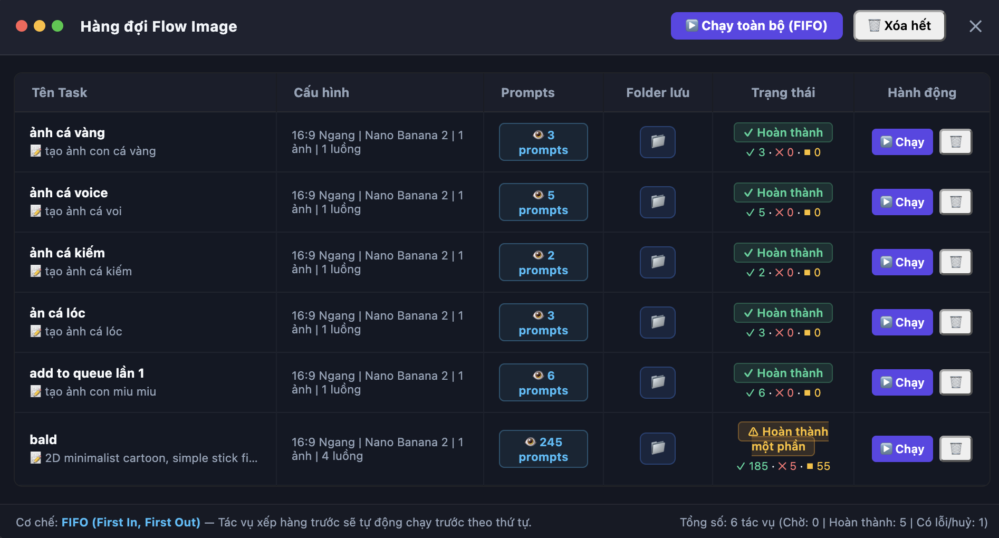

### Flow Video

Flow Video cung cấp khả năng tạo video mạnh mẽ với 2 chế độ tạo video từ ảnh:

- **Model đa dạng:**
  - **Omni 1.1 Flash:** hỗ trợ độ phân giải **360p** và **720p**, thời lượng linh hoạt **4s, 6s, 8s, 10s**.
  - **Veo 3.1 (Lite, Fast, Quality):** thời lượng 8 giây chuẩn điện ảnh.
- **Tỷ lệ khung hình:** `16:9` (ngang) và `9:16` (dọc).
- **2 chế độ Image-to-Video linh hoạt:**
  1. **Khung hình (Frames mode):** Nối tiếp chuyển động mượt mà từ ảnh đầu (Start frame) đến ảnh cuối (End frame).
  2. **Ảnh tham chiếu (Ingredients / R2V mode):** Tải lên tối đa **3 ảnh tham chiếu** để AI bám sát nhận diện nhân vật (`@Image1`, `@Image2`), phong cách hoặc bối cảnh.
- **Tự động dự phòng (Fallback to Google Vids):** Khi tài khoản Flow hết quota hoặc gặp sự cố kết nối, SukiFlow có thể tự động chuyển tiếp prompt và ảnh tham chiếu sang Google Vids để tiếp tục tạo video mà không làm gián đoạn chuỗi công việc.
- Tuỳ chọn làm sạch watermark, điều chỉnh số luồng và chọn thư mục lưu trữ.

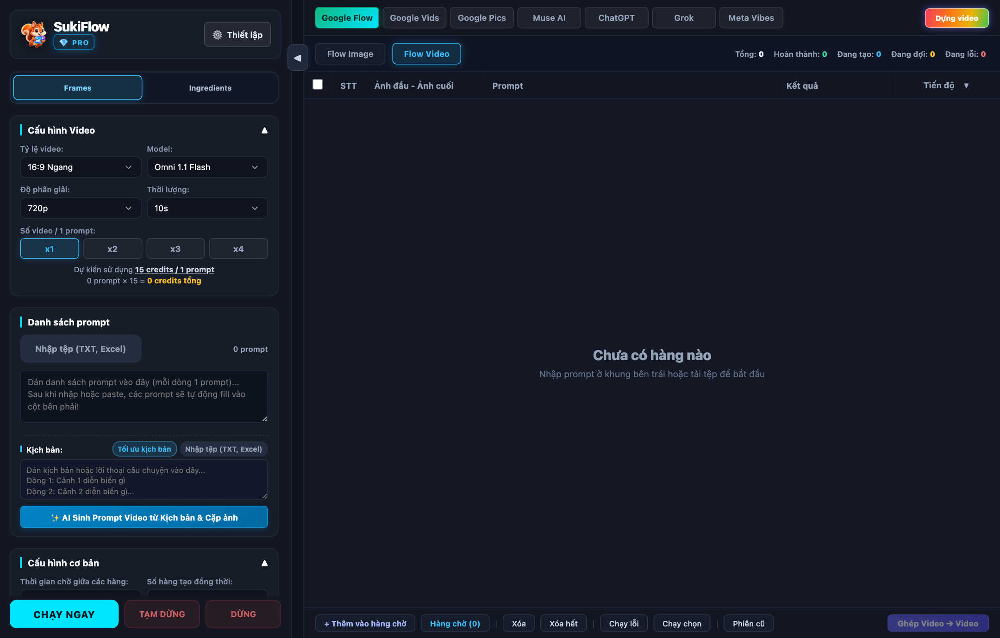

---

## Google Vids

Google Vids tích hợp cả hai chức năng tạo Video và tạo Ảnh trong cùng một giao diện làm việc:

### Vids Video

- Tạo video từ văn bản hoặc từ tối đa **3 ảnh tham chiếu**.
- Thời lượng linh hoạt: **3, 4, 5, 6, 8, 10, 12 hoặc 15 giây** (mặc định 5s).
- Tỷ lệ khung hình: `16:9` (Landscape), `9:16` (Portrait) và `1:1` (Square).
- Độ phân giải: **720p** hoặc **1080p**.
- Tự động nhận diện nhân vật qua cú pháp `@TênNhânVật`.
- Chuyển nhanh video hoàn thành sang Auto Flow để ghép nối thành video dài.


### Vids Image

- Tạo ảnh đơn lẻ hoặc hàng loạt với các preset phong cách phong phú: *Photography, Vector art, Sketch, Watercolor, Cyberpunk, Background, v.v.*
- Tỷ lệ: `16:9`, `9:16`, `1:1`.
- Hỗ trợ ảnh tham chiếu và gán nhân vật `@TênNhânVật`.

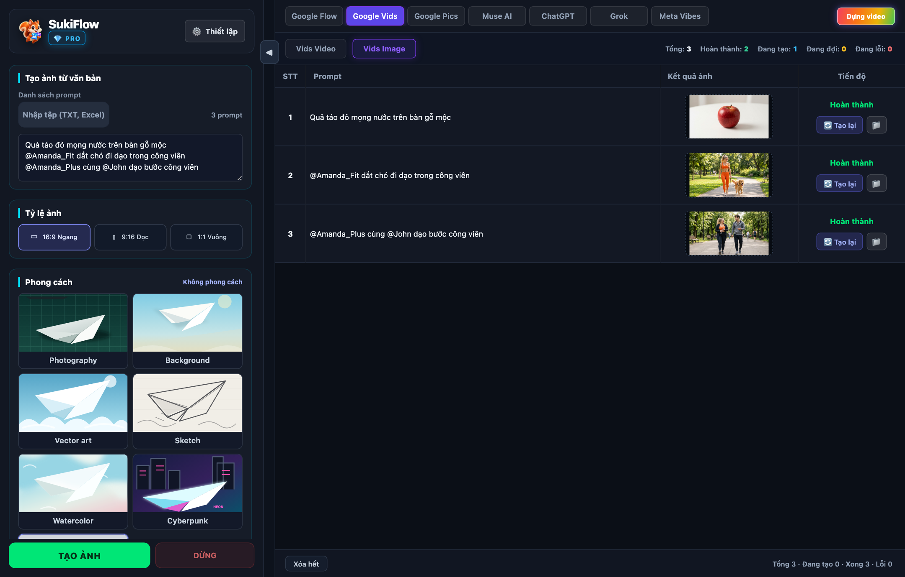

---

## Google Pics

Google Pics cung cấp quy trình tạo ảnh hàng loạt độc lập với chất lượng sắc nét:

- Hỗ trợ các tỷ lệ ảnh phổ biến: `16:9`, `9:16`, `1:1`, `4:3`, `3:4`.
- Kích thước xuất ảnh: **Gốc (Original)**, **2K JPEG** hoặc **4K JPEG**.
- Tạo tối đa 4 ảnh trên mỗi prompt.
- Tự động nhận diện nhân vật qua cú pháp `@TênNhânVật`.
- Hỗ trợ tối đa 3 ảnh tham chiếu cho mỗi tác vụ.
- Quản lý hàng đợi, tự động thử lại khi lỗi và mở lại phiên làm việc cũ.


---

## ChatGPT Image

Tích hợp trực tiếp khả năng tạo ảnh từ mô hình ChatGPT:

- **2 chế độ hoạt động:**
  - **Văn bản → Ảnh (Text-to-Image):** Tạo ảnh chi tiết từ mô tả văn bản.
  - **Ảnh → Ảnh (Image-to-Image):** Biến đổi ảnh nguồn dựa trên tối đa **5 ảnh tham chiếu**.
- **Chất lượng ảnh:** Tuỳ chọn `auto`, `high`, `medium`, `low`.
- **Tỷ lệ khung hình:** `16:9`, `1:1`, `3:2`, `2:3`, `9:16`.
- Tạo từ 1 đến 4 ảnh cho mỗi prompt, hỗ trợ thiết lập thời gian chờ (`wait_seconds`) giữa các ảnh để tránh giới hạn tần suất.
- Hỗ trợ thêm phong cách bổ sung qua trường **Style prompt**.

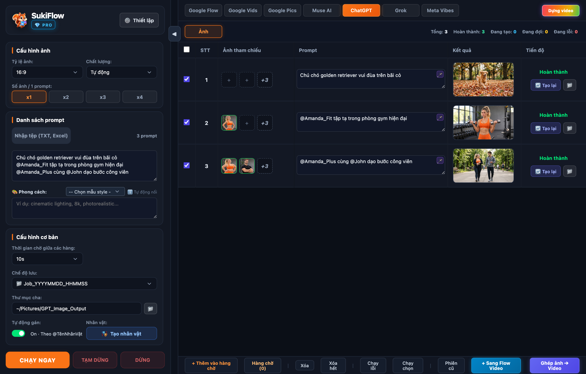

---

## Muse AI

Muse AI hỗ trợ tạo cả Video và Ảnh thông qua phiên trình duyệt tự động hoá:

- **Muse AI Video:** Tạo video với tỷ lệ `16:9` hoặc `9:16`, thời lượng khuyến nghị 10 giây (hỗ trợ điều khiển qua prompt 5s–10s), định dạng xuất linh hoạt **MP4**, **WebM**, **MOV**. Nhận tối đa **5 ảnh tham chiếu**.
- **Muse AI Image:** Tạo ảnh chất lượng cao theo prompt hoặc tối đa **5 ảnh tham chiếu**.
- Hỗ trợ cấu hình timeout tuỳ chỉnh (60s đến 900s) cho các video phức tạp.

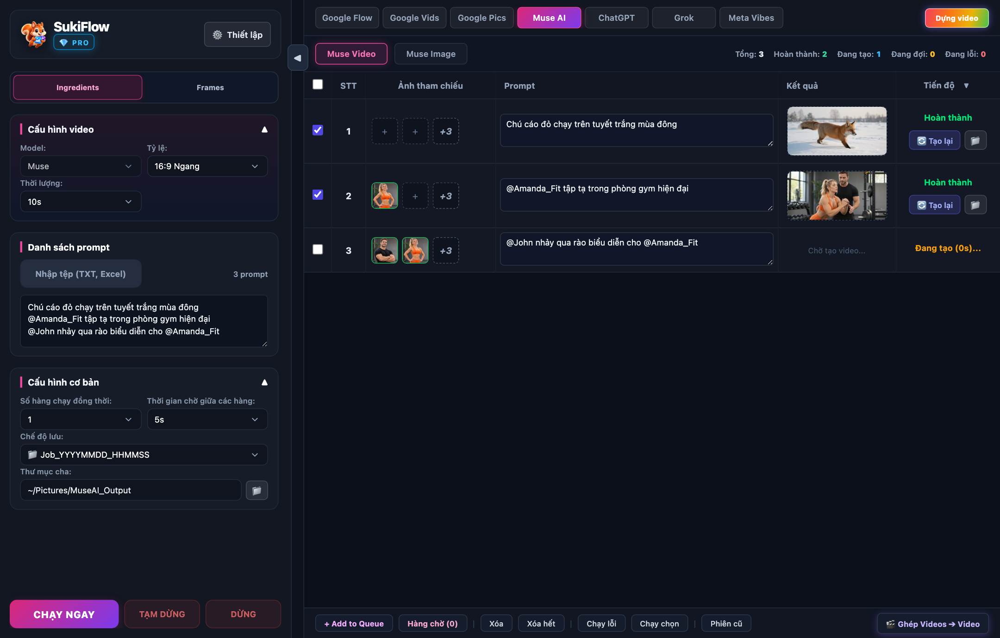

> Muse AI có thể yêu cầu tài khoản được cấp quyền hoặc cấu hình mạng tương thích theo chính sách của Muse.

---

## Auto Flow (Video Builder)

Auto Flow là xưởng dựng video hoàn chỉnh, kết hợp các tài nguyên hình ảnh, video clip, giọng đọc AI và nhạc nền thành các tác phẩm video hoàn thiện cho YouTube, TikTok, Facebook Reels.

### 1. Ảnh → Video (Montage)

- Dựng video hoàn chỉnh từ một thư mục ảnh hoặc từ ảnh được chuyển sang từ Flow Image / Google Pics.
- Tuỳ chỉnh hiệu ứng chuyển động và góc máy riêng cho từng phân cảnh.
- Tạo giọng đọc AI (hỗ trợ Gemini, AI33, Edge TTS) hoặc tải lên file voice thu sẵn.
- Tự động canh chỉnh timeline, tạo phụ đề động và trộn nhạc nền.

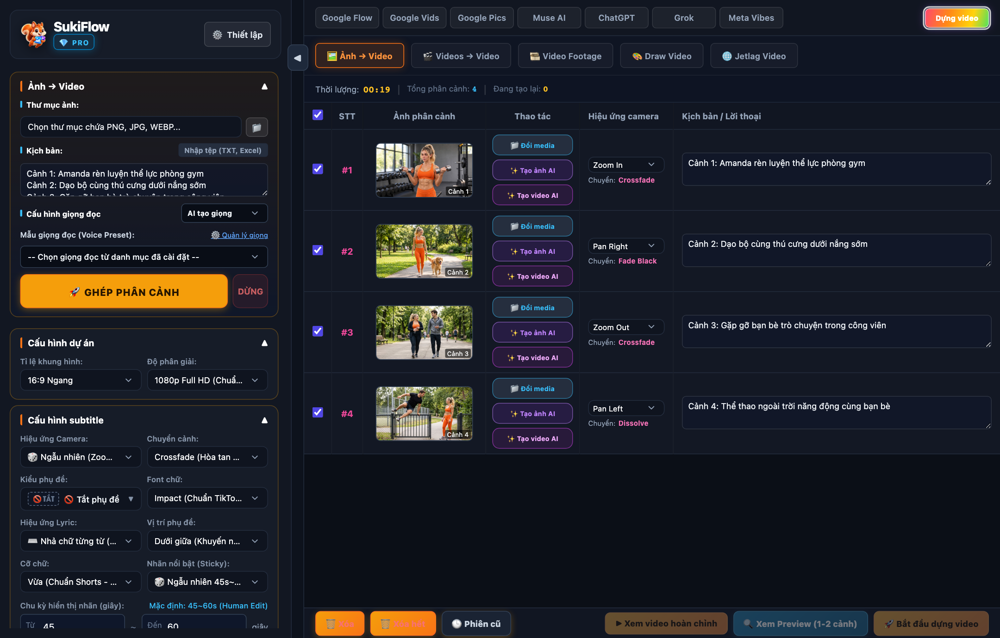

### 2. Videos → Video

- Ghép nối nhiều video clip ngắn thành một video dài liền mạch.
- Sắp xếp thứ tự, cắt gọt phân cảnh, bật/tắt âm thanh gốc của clip.
- Lồng thêm giọng đọc dẫn chuyện, nhạc nền và phụ đề tự động.


### 3. Stock Video

- Tự động lên ý tưởng và kịch bản phân cảnh từ một chủ đề cho trước.
- Tự động tìm kiếm và tải video stock chất lượng cao từ **Pexels** và **Pixabay**.
- Linh hoạt chuyển đổi từng phân cảnh sang Video AI bằng Google Flow, Google Vids hoặc Muse AI.
- Tự động xuất video với đầy đủ voice, nhạc nền và phụ đề.


### 4. Draw Video

- Chuyển kịch bản hoặc chủ đề thành video hoạt họa phong cách nét vẽ (Hand-drawn / Sketch animation), kết hợp giọng đọc và nhịp điệu sinh động.

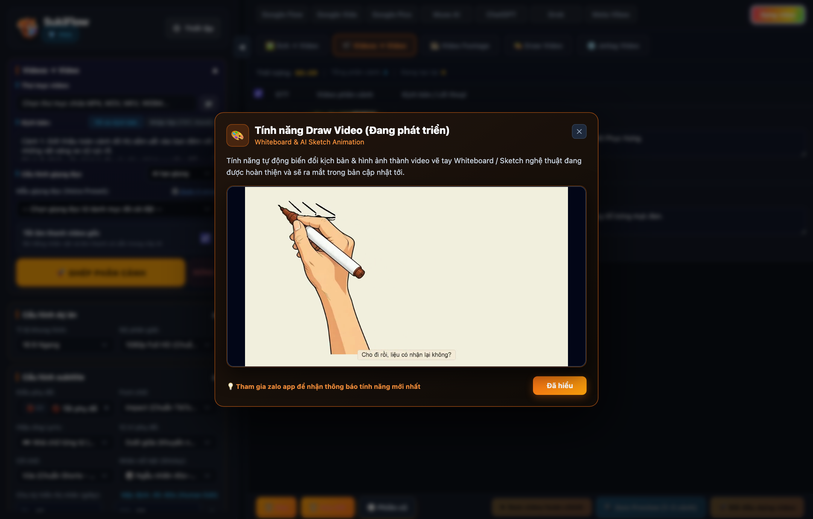

### 5. Jetlag Video

- Module chuyển đổi video gốc sang các phiên bản đa ngôn ngữ cho thị trường quốc tế (đang hoàn thiện).

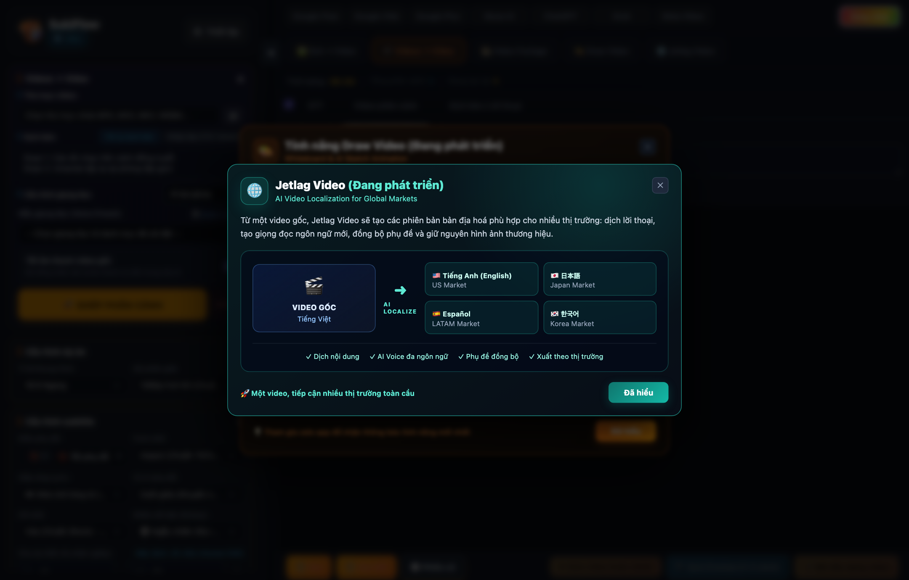

---

## Thư viện Character, Visual, Narrative và Voice

### Character (Nhân vật)

Lưu trữ thông tin và ảnh tham chiếu của nhân vật. Khi nhập prompt, bạn chỉ cần gõ `@TênNhânVật`, SukiFlow sẽ tự động đính kèm ảnh tham chiếu của nhân vật đó vào Google Flow, Google Vids, Google Pics hoặc ChatGPT.

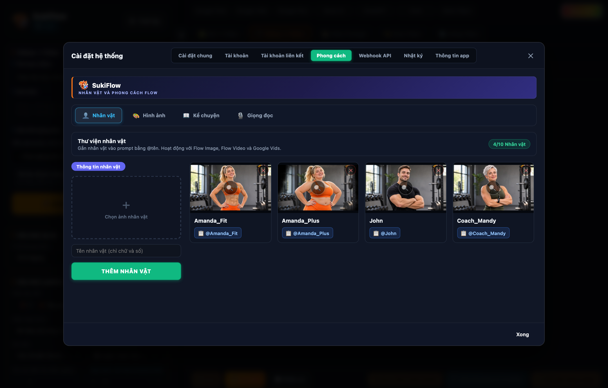

### Visual (Phong cách hình ảnh)

Lưu các preset phong cách mỹ thuật (Lighting, Palette, Art style, Camera) để tái sử dụng nhanh chóng mà không cần gõ lại prompt dài.

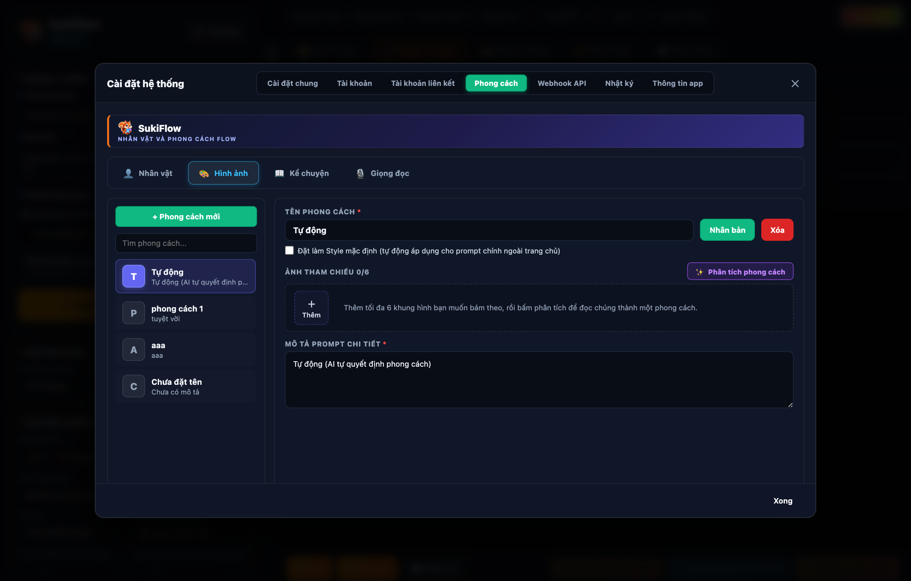

### Narrative (Phong cách kể chuyện)

Lưu trữ các DNA văn phong kịch bản (cách mở đầu Hook, nhịp điệu lời thoại, cấu trúc hồi) hoặc sử dụng tính năng **Sao chép phong cách** từ đường link kênh YouTube/TikTok để AI viết kịch bản theo đúng giọng điệu mong muốn.

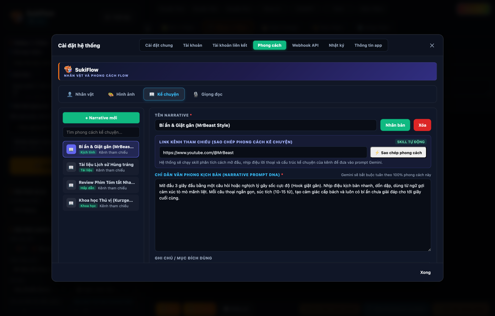

### Voice (Giọng đọc)

Quản lý danh sách giọng đọc AI, voice ID, tốc độ và cao độ để áp dụng đồng bộ trong Auto Flow.

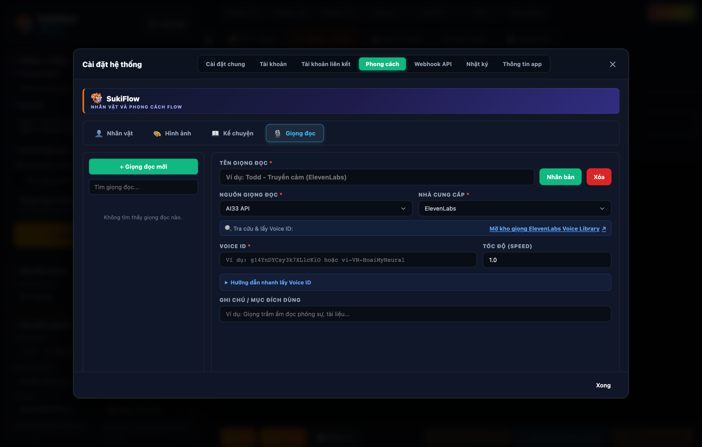

---

## Máy chủ Webhook API

SukiFlow 1.2.0 tích hợp sẵn một **máy chủ REST Webhook API độc lập** (cổng mặc định `10790`), cho phép kết nối SukiFlow với các nền tảng tự động hoá như **n8n, Make.com, Zapier**, hoặc script Python / cURL để tạo ảnh và video từ xa mà không cần thao tác thủ công trên giao diện.

### Điểm nổi bật của Webhook API:

- **Bảo mật bằng Khóa API (`X-API-Key`):** Mọi request tạo media đều được xác thực an toàn.
- **Điều khiển mạng linh hoạt:** Có thể chọn chỉ chạy nội bộ trên máy (`127.0.0.1`) hoặc mở rộng cho mạng cục bộ (`0.0.0.0` - LAN) để các máy khác trong cùng mạng gọi API.
- **Theo dõi nhật ký thời gian thực:** Xem lịch sử gọi API (phương thức, đường dẫn, mã HTTP, IP client) ngay trong giao diện cài đặt.
- **Trang Webhook Playground (`/webhook-test`):** Giao diện thử nghiệm trực quan tích hợp sẵn tại `http://127.0.0.1:10789/webhook-test` giúp bạn test nhanh mọi endpoint, xem mã JSON gửi đi/nhận về, kiểm tra tải file kết quả và gửi batch tới 100 prompt đồng thời.

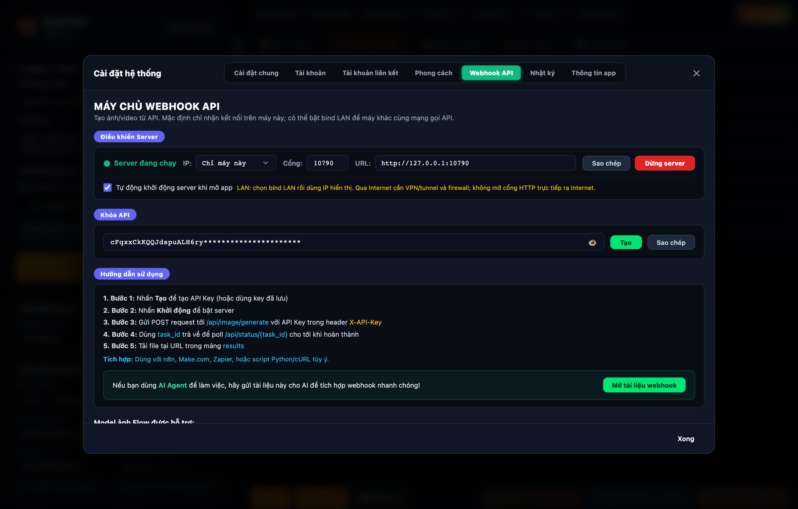

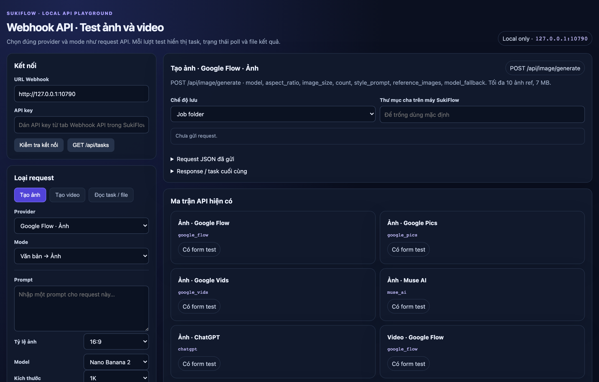

### Danh sách Endpoint chính:

| Phương thức | Endpoint | Yêu cầu Auth | Mô tả |
|---|---|:---:|---|
| `GET` | `/api/health` | Không | Kiểm tra trạng thái máy chủ Webhook và số task đang xử lý |
| `POST` | `/api/image/generate` | Có | Tạo ảnh qua Google Flow, Google Pics, Google Vids Image, Muse AI hoặc ChatGPT |
| `POST` | `/api/video/generate` | Có | Tạo video qua Google Flow, Google Vids hoặc Muse AI |
| `GET` | `/api/status/{task_id}` | Có | Tra cứu tiến độ và URL kết quả của task |
| `GET` | `/api/tasks` | Có | Liệt kê tối đa 50 task gần nhất |
| `GET` | `/api/files/{file_id}` | Có | Tải file ảnh hoặc video đã hoàn thành về máy |

📖 Xem hướng dẫn tích hợp chi tiết, schema dữ liệu và code mẫu cURL / Python tại: **[Tài liệu Webhook API đầy đủ (WEBHOOK_API.md)](WEBHOOK_API.md)**.

---

## Dữ liệu và quyền riêng tư

- SukiFlow là ứng dụng desktop cục bộ; toàn bộ file ảnh, video, kịch bản và dữ liệu dự án được lưu trực tiếp trên ổ cứng máy bạn theo thư mục đã chọn.
- Phiên đăng nhập của các nền tảng được lưu an toàn trong vùng dữ liệu ứng dụng để không phải đăng nhập lại mỗi khi mở phần mềm.
- Đăng xuất thiết bị trong SukiFlow không xoá Linked Accounts; bạn có thể quản lý, bật/tắt hoặc xoá từng tài khoản trong **Setting → Linked Accounts**.
- Không chia sẻ file cấu hình `webhook_api.json`, API Key, cookie hoặc profile trình duyệt cho người khác.
- SukiFlow sử dụng trình duyệt để tương tác tự động với các nền tảng bên thứ ba. Bạn chịu trách nhiệm tuân thủ điều khoản dịch vụ và chính sách của từng nền tảng tương ứng.

### Thư mục đầu ra mặc định

| Module | Thư mục mặc định |
|---|---|
| Google Flow Image / Video | `~/Pictures/GoogleFlow_Output` |
| Google Pics | `~/Pictures/GooglePics_Output` |
| Muse AI | `~/Pictures/MuseAI_Output` |
| Auto Flow | `~/Pictures/AutoFlow_Output` |

---

## Khắc phục sự cố

### 1. Trạng thái kết nối không chuyển sang hoạt động
- Khi chưa có tác vụ, SukiFlow ở chế độ chờ. Khi bắt đầu chạy prompt, worker sẽ mở cửa sổ trình duyệt và kết nối.
- Tuyệt đối không tắt cửa sổ trình duyệt tự động được mở bởi SukiFlow trong lúc tác vụ đang chạy.

### 2. Báo lỗi "Chưa có Linked Account khả dụng"
- Mở **Setting → Linked Accounts**, chọn đúng dịch vụ (Google Flow, Google Vids, Google Pics, Muse AI) rồi bấm **Thêm tài khoản**. Tài khoản của dịch vụ này không tự thay thế cho dịch vụ khác.

### 3. Cài đè trên Windows báo “Access is denied”
- Đóng hoàn toàn SukiFlow và các tiến trình nền liên quan, sau đó chạy lại bộ cài đặt EXE. Không bấm **Skip this file**.

### 4. Webhook API báo lỗi 401 Unauthorized
- Kiểm tra header `X-API-Key` trong request đã khớp chính xác với Khóa API trong **Setting → Webhook API** chưa.

### 5. Gọi Webhook từ máy khác trong mạng LAN không được
- Vào **Setting → Webhook API**, tại ô IP chuyển từ `Chỉ máy này (127.0.0.1)` sang `Mạng LAN (0.0.0.0)`. Đảm bảo tường lửa (Firewall) trên máy cài SukiFlow cho phép mở cổng `10790`.

### 6. Tác vụ tạo ảnh hoặc video phản hồi chậm
- Kiểm tra tài khoản có bị giới hạn tốc độ (rate limit) hoặc hết hạn mức/credit trên nền tảng không.
- Thử giảm số luồng chạy đồng thời xuống 1 để kiểm tra.
- Mở **Setting → Logs** để xem chi tiết log lỗi thực tế.

---

## Cập nhật

SukiFlow tự động kiểm tra chính sách phiên bản khi khởi động. Luôn tải bản cài đặt chính thức từ:

**[GitHub Releases — SukiFlow](https://github.com/suki-app/sukiflow-doc/releases/latest)**

---

## Lưu ý

SukiFlow là công cụ hỗ trợ tự động hoá quy trình sáng tạo. SukiFlow không thuộc, không được tài trợ và không được xác nhận bởi Google, OpenAI, Meta, Pexels, Pixabay hoặc các nền tảng bên thứ ba được nhắc đến. Mọi tên thương hiệu thuộc về chủ sở hữu tương ứng.

<p align="center">
  <br>
  <strong>SukiFlow 1.2.0</strong><br>
  © 2026 SukiFlow
</p>
