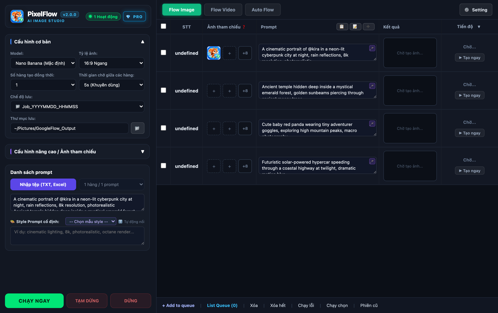
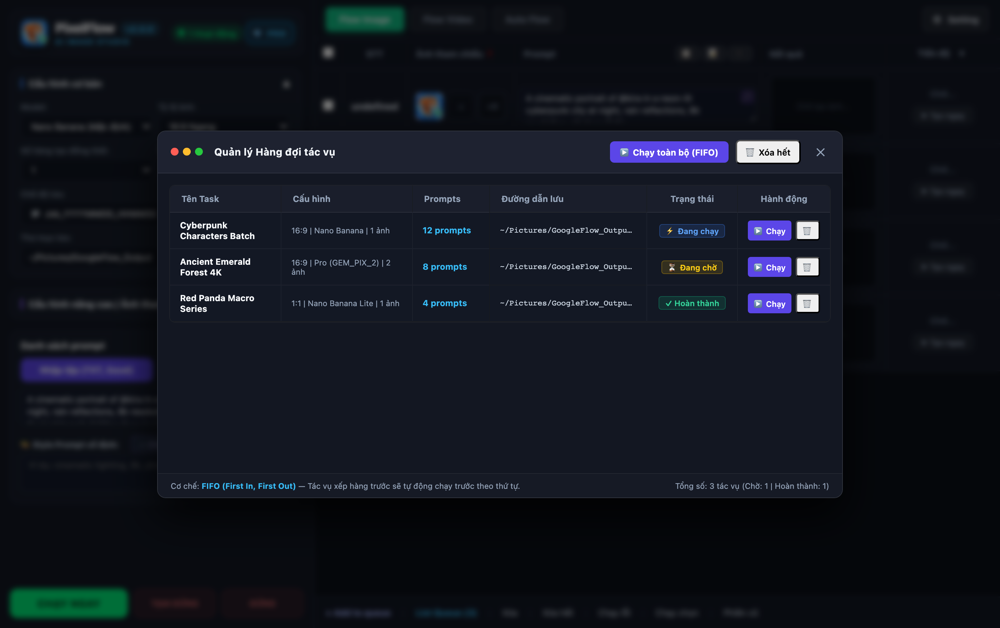
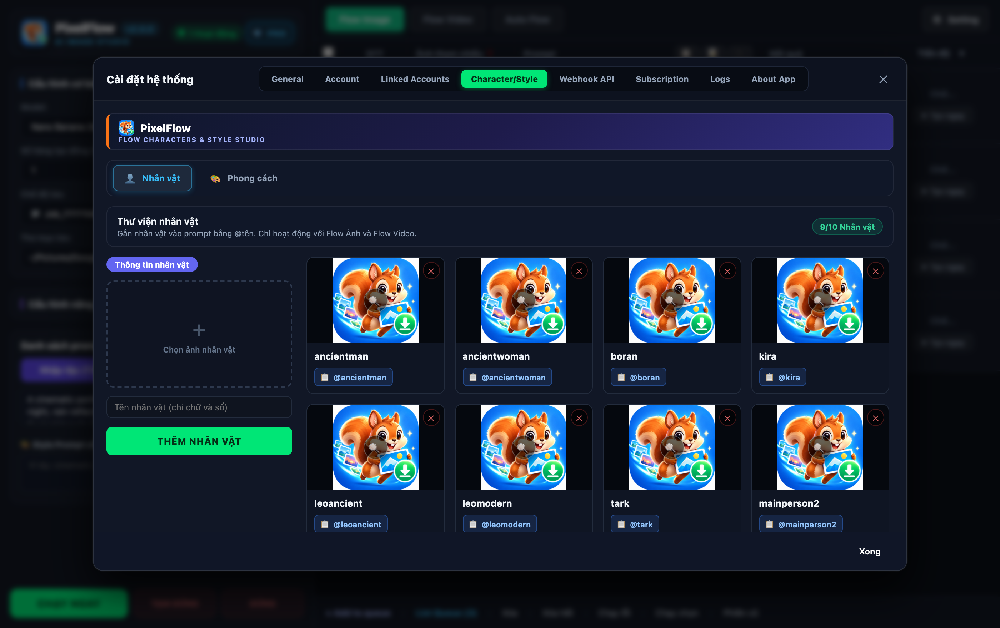
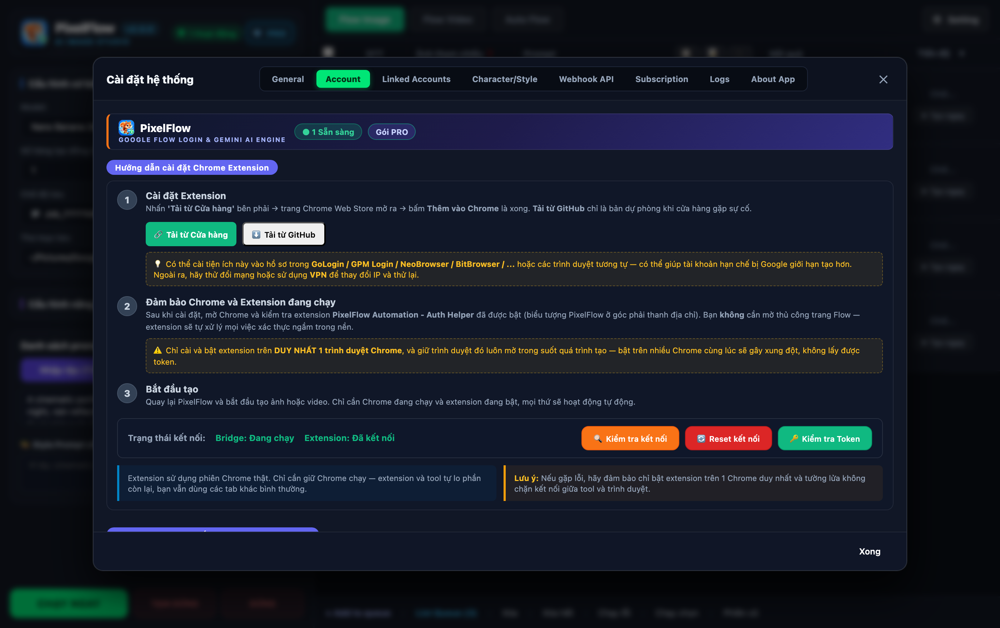
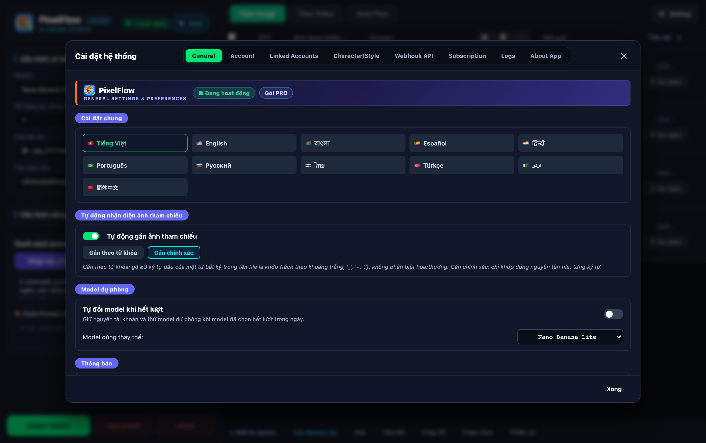
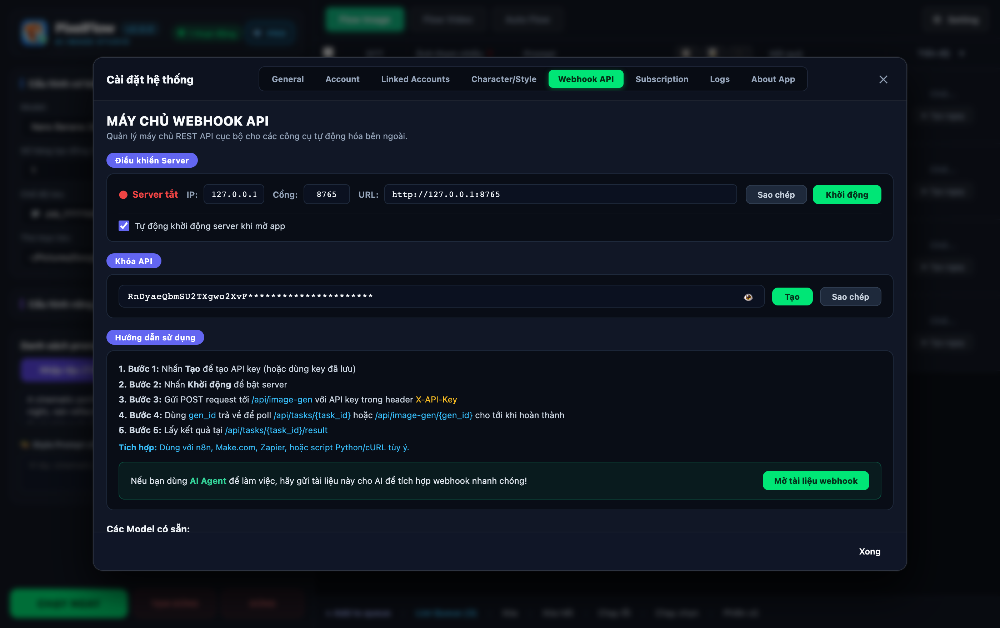
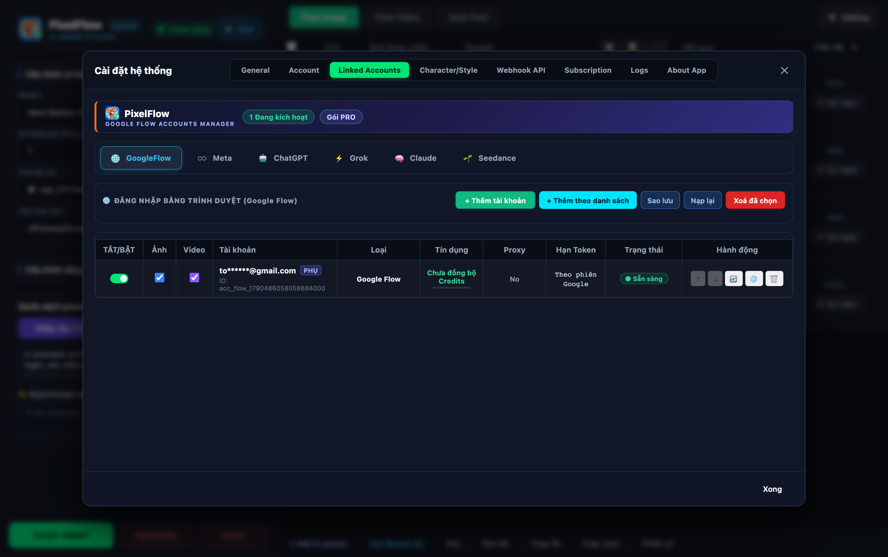

<h1 align="center">⚡ PixelFlow Studio</h1>

<p align="center"><b>Ứng dụng Desktop chuyên nghiệp để tạo hàng loạt ảnh AI trên Google Flow (Nano Banana, Imagen 3.5, Gemini Pro) với hiệu suất tối đa, quản lý hàng đợi FIFO, kho nhân vật tham chiếu và Webhook API tự động hóa.</b></p>

<p align="center">
  <a href="dist_releases/PixelFlow_Windows_v2.0.zip"></a>&nbsp;
  <a href="dist_releases/PixelFlow_macOS_v2.0.dmg"></a>&nbsp;
  <a href="dist_releases/PixelFlow_macOS_v2.0.zip"></a>
</p>

---

## 📑 Mục lục
- [Cài đặt](#cài-đặt)
  - [Bước 1 — Tải phiên bản phù hợp](#bước-1--tải-phiên-bản-phù-hợp)
  - [Bước 2 — Cài đặt trên máy](#bước-2--cài-đặt-trên-máy)
  - [Bước 3 — Kết nối Google Flow](#bước-3--kết-nối-google-flow)
- [Tính năng cốt lõi](#tính-năng-cốt-lõi)
- [Hướng dẫn chi tiết từng màn hình](#hướng-dẫn-chi-tiết-từng-màn-hình)
  - [1. Flow Image — Trình tạo ảnh hàng loạt](#1-flow-image--trình-tạo-ảnh-hàng-lượt)
  - [2. Hàng đợi tác vụ (Task Queue FIFO)](#2-hàng-đợi-tác-vụ-task-queue-fifo)
  - [3. Kho nhân vật & Phong cách (Character & Style)](#3-kho-nhân-vật--phong-cách-character--style)
  - [4. Xác thực & Cầu nối Chrome Extension](#4-xác-thực--cầu-nối-chrome-extension)
  - [5. Cài đặt chung & Quy tắc đặt tên file](#5-cài-đặt-chung--quy-tắc-đặt-tên-file)
  - [6. Webhook API Cục bộ](#6-webhook-api-cục-bộ)
- [Nơi lưu trữ dữ liệu](#nơi-lưu-trữ-dữ-liệu)
- [Khắc phục sự cố thường gặp (FAQ)](#khắc-phục-sự-cố-thường-gặp-faq)

---

## Cài đặt

### Bước 1 — Tải phiên bản phù hợp

Tải gói cài đặt tương ứng với hệ điều hành của bạn:

| Hệ điều hành | File cài đặt | Định dạng | Ghi chú |
|---|---|---|---|
| 🍎 **macOS (Apple Silicon & Intel)** | **`PixelFlow_macOS_v2.0.dmg`** | File đĩa DMG | Khuyên dùng cho macOS 12+ |
| 🍎 **macOS (Bản nén ZIP)** | **`PixelFlow_macOS_v2.0.zip`** | File nén ZIP | Giải nén dùng ngay |
| 🪟 **Windows 10/11 (64-bit)** | **`PixelFlow_Windows_v2.0.zip`** | Bản Portable / Installer | Hỗ trợ Windows 10/11 |

---

### Bước 2 — Cài đặt trên máy

<details open>
<summary><b>🍎 Hướng dẫn cài đặt trên macOS</b></summary>

1. Mở file **`PixelFlow_macOS_v2.0.dmg`** vừa tải về.
2. Kéo biểu tượng **PixelFlow.app** thả vào thư mục **Applications**.
3. **Mở lần đầu**:
   - Vào thư mục `Applications`, **bấm chuột phải** (hoặc giữ phím `Control` rồi bấm chuột) vào **PixelFlow** → chọn **Open** → bấm **Open** ở hộp thoại xác nhận của macOS.
4. *(Tùy chọn)* Nếu máy hiển thị cảnh báo *"Ứng dụng bị hỏng hoặc không thể mở"* do cơ chế Gatekeeper của macOS, mở **Terminal** và dán lệnh sau:
   ```bash
   xattr -dr com.apple.quarantine "/Applications/PixelFlow.app"
   ```
5. Nhấp đúp chuột để mở ứng dụng bình thường ở những lần tiếp theo.

</details>

<details open>
<summary><b>🪟 Hướng dẫn cài đặt trên Windows</b></summary>

1. Giải nén file **`PixelFlow_Windows_v2.0.zip`** vào một thư mục (ví dụ `D:\PixelFlow`).
2. Mở file **`PixelFlow.exe`** (hoặc chạy `Chay_PixelFlow_Windows.bat`).
3. Nếu Windows SmartScreen hiển thị thông báo *"Windows protected your PC"*:
   - Bấm **More info** → chọn **Run anyway**.
4. Ứng dụng sẽ tự động mở giao diện PixelFlow Studio trong cửa sổ App Mode độc lập.

</details>

---

### Bước 3 — Kết nối Google Flow

PixelFlow hỗ trợ **2 cơ chế kết nối linh hoạt**:

1. **Cơ chế Trình duyệt Tự động (Khuyên dùng)**:
   - Khi khởi động, ứng dụng tự động mở phiên trình duyệt riêng biệt kết nối trực tiếp đến Google Flow.
   - Bạn chỉ cần đăng nhập tài khoản Google Flow một lần đầu, phiên làm việc sẽ được duy trì và tự động làm nóng dự án `PixelFlow Session`.
2. **Cơ chế Chrome Extension Bridge**:
   - Dùng khi bạn muốn kết nối qua profile Chrome cá nhân hoặc trình duyệt Antidetect Browser (Genlogin, MoreLogin, AdsPower...).
   - Vào `chrome://extensions/` → Bật **Developer mode** → Chọn **Load unpacked** thư mục `extension` trong PixelFlow.

---

## Tính năng cốt lõi



- ⚡ **Hiệu suất cực cao — Giữ phiên duy nhất**: Trình duyệt Google Flow chỉ mở đúng 1 lần khi bắt đầu và được duy trì liên tục. Loại bỏ hoàn toàn tình trạng tải lại trang web giữa các prompt, giúp tốc độ sinh ảnh chỉ mất từ 1–3 giây.
- 🎯 **Hỗ trợ đầy đủ Model & Tỷ lệ**:
  - Mô hình: **Nano Banana (Mặc định)**, **Nano Banana Lite**, **Omini Flash**, **Imagen 3.5**, **Pro (GEM_PIX_2)**.
  - Tỷ lệ: `16:9 Ngang`, `9:16 Dọc`, `1:1 Vuông`, `4:3 Ngang`, `3:4 Dọc`.
  - Sinh từ **1 đến 4 ảnh** đồng thời cho mỗi prompt.
- 📦 **Hàng đợi tác vụ FIFO (Task Queue)**: Đóng gói các lô prompt thành từng tác vụ độc lập, cấu hình riêng biệt và thực thi tuần tự tự động.
- 🎭 **Kho nhân vật & Phân tích Style (OpenMontage)**: Quản lý thư viện nhân vật tham chiếu với cú pháp `@tên_nhân_vật` ngay trong prompt. Trích xuất và lưu trữ phong cách nghệ thuật từ ảnh mẫu.
- 🏷️ **Tùy biến quy tắc đặt tên file ảnh**: Cấu hình tự động lưu ảnh theo cú pháp chuẩn `{stt}_{prompt_clean}_{count}` với màn hình xem trước thời gian thực.
- 🌐 **Webhook API cục bộ**: Tích hợp sẵn máy chủ REST API cục bộ để các bot, tác nhân AI hoặc script tự động hóa bên ngoài gửi tác vụ sinh ảnh và nhận kết quả.
- 🛡️ **Tự động phục hồi lỗi & Chống trôi bộ nhớ**: Tự động nhận diện và tắt Agent Mode, tự đóng dialog chào mừng, tự động làm sạch DOM sau khi hoàn thành.

---

## Hướng dẫn chi tiết từng màn hình

### 1. Flow Image — Trình tạo ảnh hàng loạt


- **Cột bên trái (Sidebar)**:
  - Chọn Mô hình AI (Nano Banana, Imagen 3.5, Pro...).
  - Chọn Tỷ lệ khung hình và Số lượng ảnh sinh ra (1–4 ảnh).
  - Khung nhập prompt: Hỗ trợ dán danh sách hàng trăm prompt (mỗi dòng một prompt) hoặc bấm **"📂 Nạp file (.txt / .xlsx / .csv)"**.
  - Chọn thư mục lưu ảnh cục bộ trên máy tính.
  - Bấm **"⚡ CHẠY NGAY"** để bắt đầu sinh ảnh ngay lập tức, hoặc bấm **"+ Add to queue"** để đưa vào hàng đợi.
- **Bảng danh sách bên phải**:
  - Hiển thị chi tiết từng prompt: Trạng thái (`⏳ Chờ`, `⚡ Đang chạy`, `✓ Hoàn thành`, `✕ Lỗi`), tiến độ thời gian thực, ảnh thumbnail kết quả và các nút hành động (Xem ảnh, Mở thư mục, Tạo lại).

---

### 2. Hàng đợi tác vụ (Task Queue FIFO)



- Mở hộp thoại Quản lý hàng đợi bằng cách bấm vào nút **"List Queue"** trên thanh công cụ.
- **Cơ chế FIFO (First-In, First-Out)**:
  - Cho phép đóng gói nhiều lô prompt khác nhau với từng cấu hình model, tỷ lệ và thư mục lưu riêng.
  - Bấm **"▶️ Chạy toàn bộ (FIFO)"**: Hệ thống tự động thực thi từng tác vụ tuần tự từ trên xuống dưới, không cần người dùng can thiệp thủ công.
  - Hỗ trợ chạy từng tác vụ đơn lẻ, tạm dừng hoặc xóa tác vụ khỏi hàng đợi.

---

### 3. Kho nhân vật & Phong cách (Character & Style)



- **Tab Nhân vật**:
  - Lưu trữ các nhân vật tham chiếu với tên nhận diện duy nhất (ví dụ `@kira`, `@ancientman`).
  - Khi viết prompt, chỉ cần gõ `@tên_nhân_vật`, hệ thống sẽ tự động đính kèm ảnh tham chiếu khuôn mặt/ngoại hình tương ứng vào trình tạo ảnh Google Flow.
- **Tab Phong cách (Style)**:
  - Hỗ trợ định nghĩa các phong cách mẫu bằng văn bản mô tả hoặc phân tích trích xuất đặc trưng hình ảnh qua OpenMontage.
  - Thiết lập Style mặc định để tự động áp dụng vào mọi prompt.

---

### 4. Xác thực & Cầu nối Chrome Extension



- Cung cấp hướng dẫn trực quan 3 bước để cài đặt và kích hoạt Chrome Extension Bridge.
- Đèn trạng thái thời gian thực:
  - `🟢 Chrome Extension đã kết nối`: Sẵn sàng nhận lệnh tạo ảnh.
  - `⚡ Bridge Server`: Đang hoạt động trên cổng nội bộ `127.0.0.1:8765`.
- Hỗ trợ các nút thao tác nhanh: *Kiểm tra kết nối*, *Đặt lại kết nối*, *Xác thực token*.

---

### 5. Cài đặt chung & Quy tắc đặt tên file



- **Quy tắc đặt tên file ảnh/video xuất ra**:
  - Tùy chỉnh tiền tố (Prefix), ký tự phân cách (Separator), số chữ số tối thiểu cho số thứ tự (STT) và độ dài rút gọn của prompt.
  - Khung **Xem trước tên file mẫu** thời gian thực (ví dụ: `1_A_cinematic_portrait_of_kira_in_a_s1.jpg`).
- **Cấu hình số lần thử lại (Retry)**:
  - Tự động thử lại khi gặp lỗi gián đoạn mạng hoặc chính sách kiểm duyệt của Google.
  - Nút **"Khôi phục mặc định"** và **"Khôi phục cài đặt gốc"**.

---

### 6. Webhook API Cục bộ



- Biến ứng dụng PixelFlow thành một máy chủ tạo ảnh tự động cho các công cụ khác (Python script, Node.js, n8n, Make, Telegram Bot...):
  - **Khởi chạy / Dừng server**: Kiểm soát trực tiếp từ giao diện.
  - **Khóa API bí mật (API Key)**: Có nút icon mắt 👁️ để ẩn/hiện key an toàn.
  - **Endpoints hỗ trợ**:
    - `POST /api/image/generate`: Gửi yêu cầu sinh ảnh hàng loạt.
    - `GET /api/status/<job_id>`: Kiểm tra trạng thái và nhận đường dẫn ảnh đã tạo.
    - `GET /api/credits`: Tra cứu số dư credit còn lại của tài khoản Google Flow.

---

### 7. Trạng thái Tài khoản Google Flow & Credits



- Giám sát trạng thái hoạt động thực tế của tài khoản Google Flow.
- Hiển thị chính xác số dư credit (ví dụ: `422 / 500 Credits PRO`).
- Che ký tự email riêng tư (`tu******@gmail.com`) để đảm bảo an toàn khi quay video hoặc chia sẻ màn hình.
- Các nút tiện ích: 🔄 *Làm mới credit*, 🌐 *Mở trang web Google Flow*, 🗑️ *Xóa tài khoản*.

---

## Nơi lưu trữ dữ liệu

| Loại dữ liệu | Đường dẫn trên macOS | Đường dẫn trên Windows |
|---|---|---|
| **Ảnh xuất ra** | `~/Pictures/GoogleFlow_Output` | `%USERPROFILE%\Pictures\GoogleFlow_Output` |
| **Kho ảnh nhân vật** | `~/Pictures/GoogleFlow_Output/characters` | `%USERPROFILE%\Pictures\GoogleFlow_Output\characters` |
| **Dữ liệu phiên làm việc** | `~/Pictures/GoogleFlow_Output/sessions` | `%USERPROFILE%\Pictures\GoogleFlow_Output\sessions` |
| **Cấu hình & Môi trường app** | `~/Library/Application Support/PixelFlow` | `%LOCALAPPDATA%\PixelFlow` |

---

## Khắc phục sự cố thường gặp (FAQ)

### 1. Trên macOS báo "Ứng dụng bị hỏng / không thể mở"?
- Đây là cơ chế Gatekeeper của Apple dành cho phần mềm chưa mua chứng chỉ nhà phát triển của Apple.
- **Cách xử lý**: Mở ứng dụng **Terminal** trên Mac, dán lệnh sau rồi bấm Enter:
  ```bash
  xattr -dr com.apple.quarantine "/Applications/PixelFlow.app"
  ```
  Sau đó mở lại ứng dụng bình thường.

### 2. Trên Windows báo "Windows protected your PC" (SmartScreen)?
- Nhấn vào chữ **More info** (Thông tin khác) → Nhấn nút **Run anyway** (Vẫn chạy). Ứng dụng hoàn toàn an toàn và chạy cục bộ 100% trên máy của bạn.

### 3. Google Flow bị đứng hoặc báo lỗi dự án không tồn tại?
- Phiên bản PixelFlow v2.0 đã tích hợp cơ chế tự động dọn sạch session cũ và tự động khởi tạo dự án mới `PixelFlow Session` trên tài khoản Google của bạn.
- Bạn chỉ cần đảm bảo đã đăng nhập tài khoản Google Flow hợp lệ trên trình duyệt.

### 4. Muốn tắt sạch ứng dụng khi cần cài đè bản mới?
- **Trên macOS**: Nhấp đúp chuột vào file **`Tat_App_PixelFlow.command`** trong thư mục dự án để dọn sạch toàn bộ tiến trình ngầm chỉ trong 1 giây.
- **Trên Windows**: Chạy file **`Tat_App_PixelFlow.bat`**.
