<p align="center">
  
</p>

<h1 align="center">SukiFlow</h1>

<p align="center">
  <strong>Giải pháp tự động hoá tạo ảnh &amp; video AI hàng loạt tối ưu trên các nền tảng.</strong>
</p>

<table align="center">
  <tr>
    <td align="center" width="260">
      <br>
      <strong>SukiFlow cho Windows</strong><br>
      <sub>64-bit · Bộ cài đặt EXE</sub><br><br>
      <a href="https://github.com/suki-app/sukiflow-doc/releases/download/v1.1.0/SukiFlow_Setup_v1.1.0.exe"></a>
    </td>
    <td align="center" width="260">
      <br>
      <strong>SukiFlow cho Mac</strong><br>
      <sub>M1 · M2 · M3 · M4</sub><br><br>
      <a href="https://github.com/suki-app/sukiflow-doc/releases/download/v1.1.0/SukiFlow_macOS_v1.1.0_arm64.dmg"></a>
    </td>
    <td align="center" width="260">
      <br>
      <strong>SukiFlow cho Mac</strong><br>
      <sub>Intel · x86_64</sub><br><br>
      
    </td>
  </tr>
</table>

<p align="center">
  <a href="README_EN.md">English</a>
  ·
  <a href="https://github.com/suki-app/sukiflow-doc/releases/latest">Phiên bản mới nhất</a>
  ·
  <a href="#cài-đặt">Hướng dẫn cài đặt</a>
  ·
  <a href="#khắc-phục-sự-cố">Khắc phục sự cố</a>
</p>

> Phiên bản hiện tại: **SukiFlow 1.0.0**. SukiFlow là ứng dụng desktop dành cho Windows và macOS. Các tính năng phụ thuộc vào dịch vụ bên thứ ba có thể thay đổi theo tài khoản, khu vực, hạn mức và chính sách của từng nền tảng.

---

## Tổng quan

SukiFlow tập trung nhiều quy trình tạo ảnh và video AI vào một ứng dụng duy nhất. Bạn có thể nhập prompt hàng loạt, quản lý nhiều tài khoản liên kết, chạy tác vụ theo hàng đợi, lưu lại phiên làm việc và chuyển kết quả giữa các công cụ mà không phải tổ chức file thủ công.

Các nhóm chức năng chính:

- **Google Flow:** tạo ảnh và video hàng loạt bằng Flow Image, Flow Video.
- **Google Pics:** tạo ảnh hàng loạt, dùng ảnh tham chiếu và chuyển kết quả sang Flow Video hoặc Auto Flow.
- **Google Vids:** tạo video và ảnh, quản lý hàng đợi và chuyển video sang Auto Flow.
- **Muse AI:** tạo video qua phiên trình duyệt Muse AI; khả năng sử dụng phụ thuộc tài khoản và khu vực.
- **Auto Flow:** dựng video từ ảnh, nhiều video, stock footage hoặc kịch bản Draw Video.
- **Linked Accounts:** quản lý riêng tài khoản Google Flow, Google Vids, Google Pics và Muse AI.
- **Thư viện sáng tạo:** lưu Character, Visual, Narrative và Voice preset để tái sử dụng.
- **Quản lý tác vụ:** chạy ngay, chạy các mục đã chọn, chạy lại mục lỗi, hàng đợi FIFO và khôi phục phiên cũ.

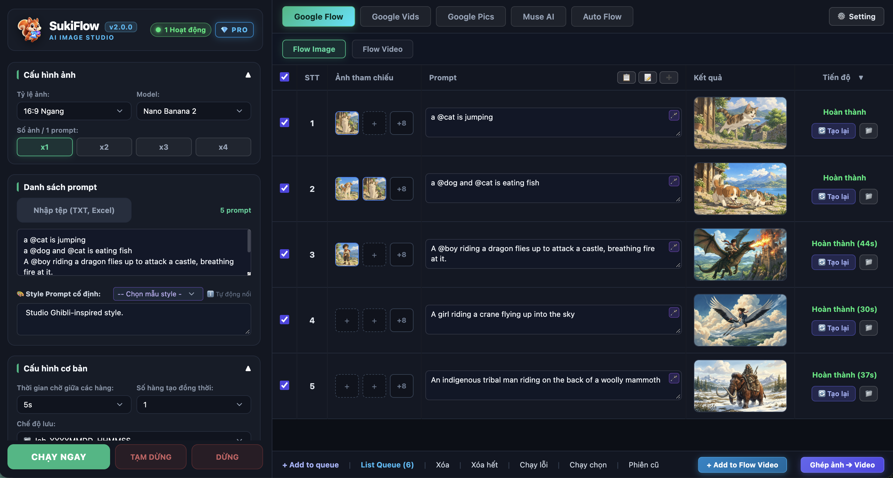

## Mục lục

- [Cài đặt](#cài-đặt)
- [Bắt đầu sử dụng](#bắt-đầu-sử-dụng)
- [Google Flow](#google-flow)
- [Google Pics](#google-pics)
- [Google Vids](#google-vids)
- [Muse AI](#muse-ai)
- [Auto Flow](#auto-flow)
- [Thư viện Character, Visual, Narrative và Voice](#thư-viện-character-visual-narrative-và-voice)
- [Dữ liệu và quyền riêng tư](#dữ-liệu-và-quyền-riêng-tư)
- [Khắc phục sự cố](#khắc-phục-sự-cố)

---

## Cài đặt

### Yêu cầu hệ thống

| Nền tảng | Phiên bản đề xuất | Gói cài đặt |
|---|---|---|
| Windows | Windows 10/11 64-bit | `SukiFlow_Setup_v1.0.0.exe` |
| macOS Apple Silicon | macOS 12 trở lên | `SukiFlow_macOS_v1.0.0_arm64.dmg` |
| macOS Intel | Đang hoàn thiện bản demo | Sắp phát hành |

Gói cài đặt chính thức đã bao gồm các thành phần cần thiết để chạy ứng dụng. Người dùng cuối không cần tự cài Python hoặc FFmpeg.

### Windows

1. Tải **SukiFlow Setup** bằng nút ở đầu trang.
2. Đóng phiên bản SukiFlow đang chạy trước khi cài hoặc cập nhật.
3. Mở `SukiFlow_Setup_v1.0.0.exe` và hoàn tất trình cài đặt.
4. Khởi chạy SukiFlow từ Start Menu hoặc shortcut trên Desktop.
5. Nếu Windows SmartScreen xuất hiện, chọn **More info** → **Run anyway**. Chỉ tải bộ cài từ trang Releases chính thức này.

### macOS

1. Tải `SukiFlow_macOS_v1.0.0_arm64.dmg`.
2. Mở file DMG và kéo **SukiFlow.app** vào thư mục **Applications**.
3. Ở lần mở đầu tiên, bấm chuột phải vào SukiFlow → **Open** → **Open**.
4. Nếu macOS vẫn chặn ứng dụng, vào **System Settings → Privacy & Security** và chọn **Open Anyway** cho SukiFlow.

Nếu macOS báo ứng dụng bị cách ly và bạn chắc chắn file được tải từ Releases chính thức, có thể chạy:

```bash
xattr -dr com.apple.quarantine "/Applications/SukiFlow.app"
```

> Bản macOS hiện phát hành cho máy Apple Silicon (`arm64`). Hãy kiểm tra loại chip tại **Apple menu → About This Mac** trước khi tải.

---

## Bắt đầu sử dụng

1. Mở SukiFlow và chọn **LOGIN GOOGLE** để đăng nhập tài khoản SukiFlow.
2. Vào **Setting → Linked Accounts**.
3. Chọn dịch vụ cần dùng rồi bấm **Thêm tài khoản**:
   - Google Flow
   - Google Vids
   - Google Pics
   - Muse AI
4. Hoàn tất đăng nhập trong cửa sổ trình duyệt được mở bởi SukiFlow.
5. Quay lại tab chức năng, nhập prompt và chọn **Chạy ngay**.

> Khi SukiFlow đang tạo ảnh hoặc video qua Google Flow, Google Vids hoặc Google Pics, không đóng cửa sổ trình duyệt tự động được mở. Đây là phiên làm việc mà ứng dụng sử dụng để điều khiển tác vụ và nhận kết quả.

Nếu chưa có tài khoản phù hợp, SukiFlow sẽ hiển thị hướng dẫn và đưa bạn đến đúng tab Linked Accounts để thêm tài khoản.

---

## Google Flow

### Flow Image

Flow Image hỗ trợ tạo ảnh hàng loạt với các cấu hình hiện có trong SukiFlow:

- Tỷ lệ `16:9`, `9:16`, `1:1`, `4:3`, `3:4`.
- Model Nano Banana 2, Nano Banana 2 Lite và Nano Banana Pro.
- Tạo từ 1 đến 4 ảnh cho mỗi prompt.
- Kích thước đầu ra 1K, 2K hoặc 4K.
- Chạy tối đa 4 hàng đồng thời, có thời gian chờ giữa các hàng.
- Nhập prompt trực tiếp hoặc từ TXT, CSV, XLSX.
- Gắn ảnh nhân vật tự động bằng cú pháp `@TênNhânVật`.
- Tuỳ chọn xử lý watermark khi môi trường máy hỗ trợ.
- Chạy mục đã chọn, chạy lại mục lỗi và khôi phục phiên cũ.
- Chuyển ảnh hoàn thành sang Flow Video hoặc Auto Flow.


### Hàng đợi Flow Image

Bạn có thể chọn một hoặc nhiều prompt rồi thêm vào hàng đợi. Mỗi tác vụ giữ cấu hình riêng và được thực thi theo thứ tự. Giới hạn số hàng đồng thời luôn được áp dụng cho cả tác vụ đang chạy và tác vụ chạy lại.

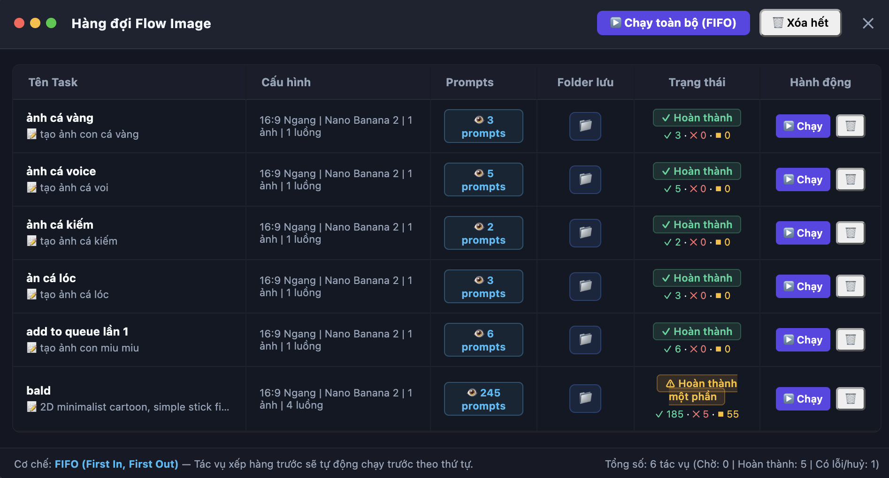

### Flow Video

Flow Video hỗ trợ tạo video từ prompt hoặc ảnh Start/End:

- Tỷ lệ `16:9` và `9:16`.
- Model Omni 1.1 Flash và các chế độ Veo 3.1 Lite, Fast, Quality.
- Độ phân giải 360p hoặc 720p.
- Thời lượng 4–10 giây theo lựa chọn model/tài khoản.
- Tạo tối đa 4 video cho mỗi prompt.
- Nối tiếp Start–End frame và nhận ảnh trực tiếp từ Flow Image hoặc Google Pics.
- Điều chỉnh số luồng, thời gian chờ, thư mục lưu và tuỳ chọn xử lý watermark.

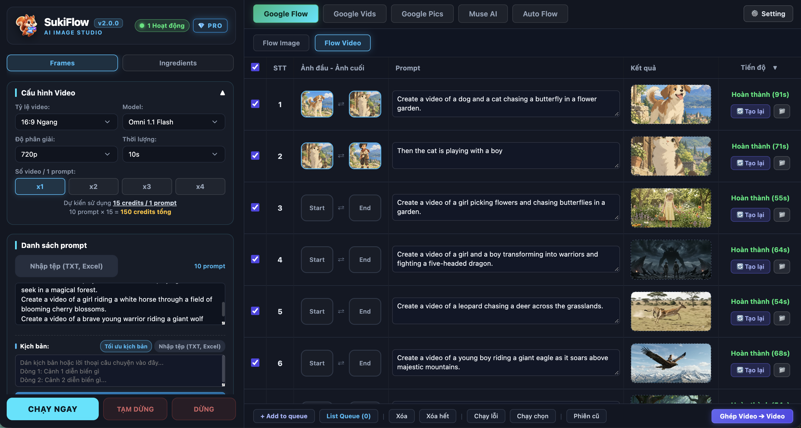

---

## Google Pics

Google Pics cung cấp quy trình tạo ảnh hàng loạt độc lập:

- Hỗ trợ các tỷ lệ ảnh phổ biến và xuất ảnh gốc, 2K hoặc 4K.
- Tạo tối đa 4 ảnh trên mỗi prompt.
- Nhập prompt từ TXT, CSV hoặc XLSX.
- Tự động nhận diện nhân vật qua cú pháp `@TênNhânVật`.
- Chạy theo hàng đợi, chạy lại lỗi, mở lại phiên cũ.
- Chuyển ảnh đã tạo sang Flow Video hoặc Auto Flow.

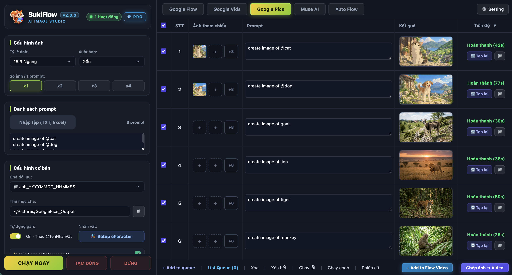

---

## Google Vids

Google Vids hỗ trợ tạo nội dung theo prompt và ảnh tham chiếu, quản lý kết quả theo từng hàng và chuyển video hoàn thành sang Auto Flow để dựng thành video dài.

- Vids Video và Vids Image trong cùng khu vực làm việc.
- Tự động gắn nhân vật đã lưu khi prompt chứa `@TênNhânVật`.
- Hàng đợi, chạy lại lỗi, chạy mục đã chọn và phiên cũ.
- Tự động lưu kết quả vào thư mục job hoặc thư mục cha đã chọn.

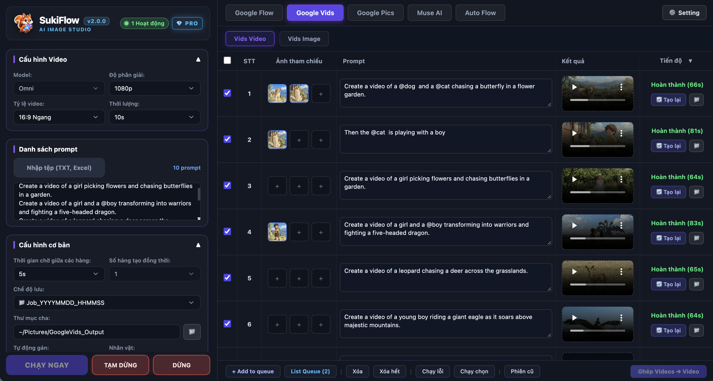

---

## Muse AI

Muse AI hỗ trợ tạo video bằng phiên trình duyệt riêng với lựa chọn tỷ lệ, thời lượng, số hàng đồng thời, thời gian chờ và thư mục lưu.

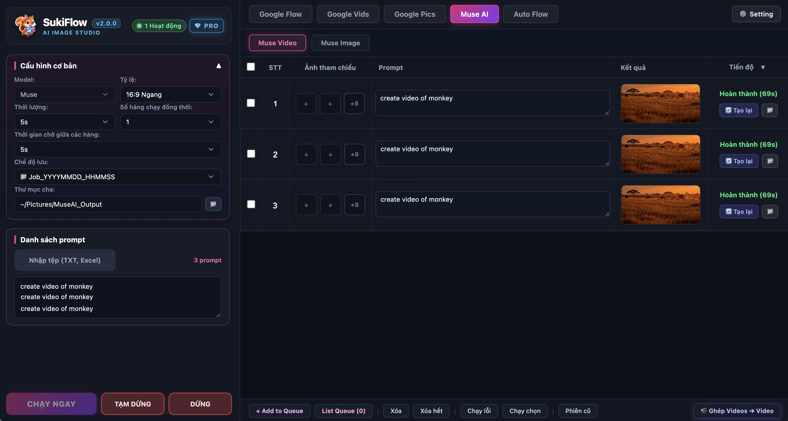

> Muse AI có thể chưa khả dụng ở một số quốc gia hoặc trên một số tài khoản. Việc sử dụng phụ thuộc quyền truy cập do nền tảng Muse cung cấp.

---

## Auto Flow

Auto Flow là khu vực dựng video hoàn chỉnh từ các nguồn media khác nhau.

### Ảnh → Video

- Ghép một thư mục ảnh hoặc ảnh được chuyển từ Flow Image/Google Pics thành video.
- Thiết lập kỹ xảo chuyển động riêng cho từng cảnh.
- Tạo voice bằng AI, sử dụng file voice có sẵn hoặc dựng không lời thoại.
- Đồng bộ timeline, phụ đề, nhạc nền và xuất video hoàn chỉnh.
- Xem preview mẫu trước khi bắt đầu dựng toàn bộ video.

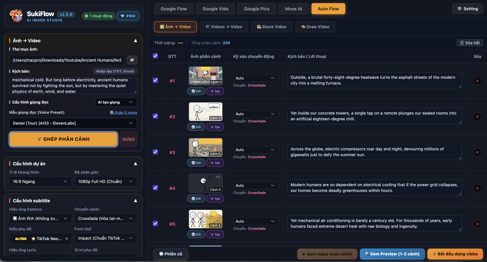

### Videos → Video

- Ghép nhiều video thành một video dài.
- Sắp xếp và chỉnh sửa từng phân cảnh.
- Giữ hoặc tắt âm thanh gốc, thêm voice, nhạc và phụ đề.

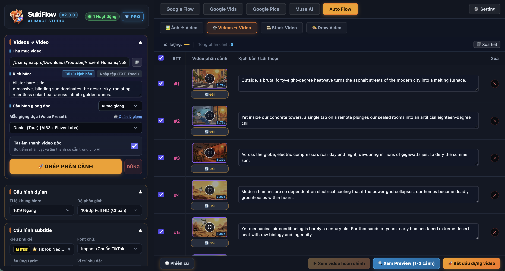

### Stock Video

- Tạo kịch bản từ chủ đề hoặc sử dụng kịch bản có sẵn.
- Tìm footage phù hợp trên Pexels và Pixabay.
- Sắp xếp footage thành phân cảnh, thêm hiệu ứng, voice, nhạc và phụ đề.
- Có thể chuyển một số cảnh sang video AI bằng Google Flow, Google Vids hoặc Muse AI.

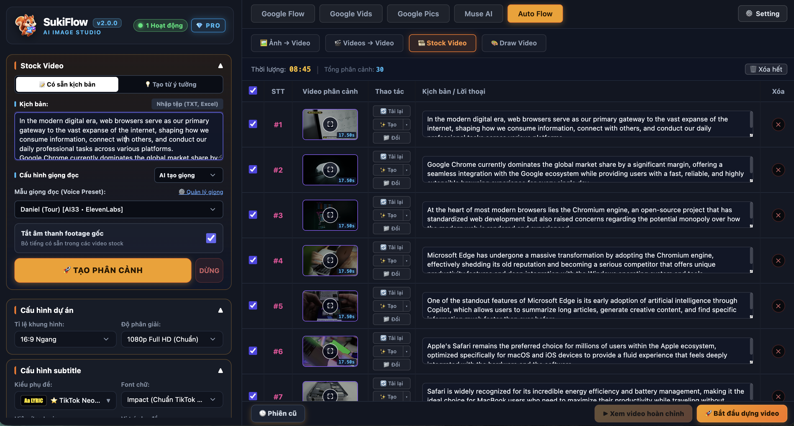

Để sử dụng Stock Video, cần cấu hình **Pexels API Key** và **Pixabay API Key** trong **Setting → General → Cài đặt API Key**. Một số bước tạo kịch bản, phân tích nội dung hoặc giọng đọc có thể yêu cầu Gemini API Key hoặc AI33 API Key; SukiFlow sẽ hiển thị nút mở đúng phần cài đặt nếu key còn thiếu.

### Draw Video

Draw Video chuyển chủ đề hoặc kịch bản thành chuỗi phân cảnh theo phong cách nét vẽ, kết hợp voice, timing, phụ đề và nhạc để dựng video hoàn chỉnh.

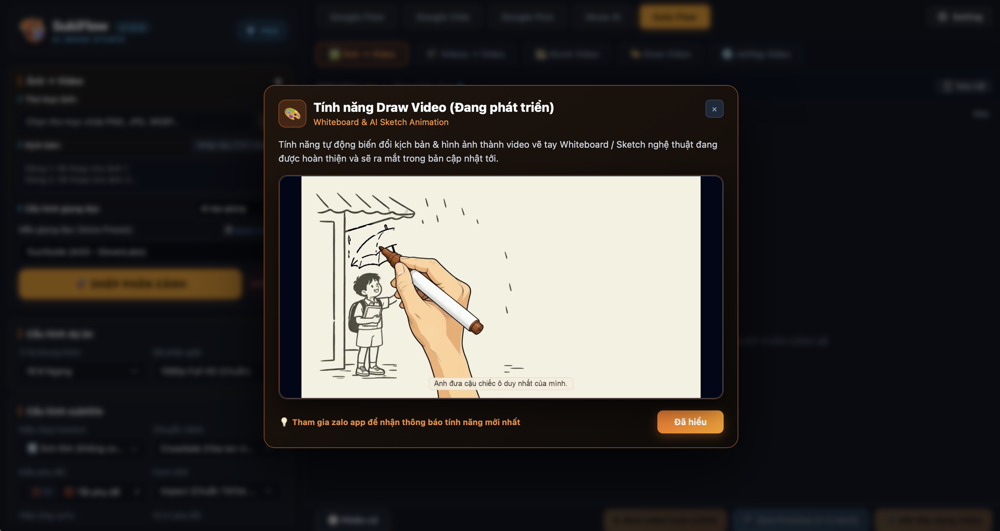

### Jetflag Video

Jetflag Video được định hướng để chuyển một video gốc thành các phiên bản phù hợp với nhiều ngôn ngữ và thị trường khác nhau. Chức năng hiện đang được phát triển.

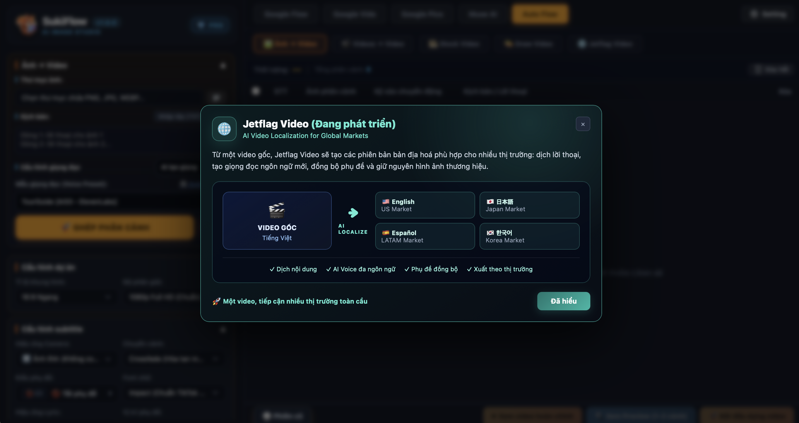

---

## Thư viện Character, Visual, Narrative và Voice

### Character

Lưu một hoặc nhiều ảnh tham chiếu cho nhân vật. Tên được giữ nguyên đúng như bạn nhập và có thể gọi trong prompt bằng cú pháp `@TênNhânVật`.

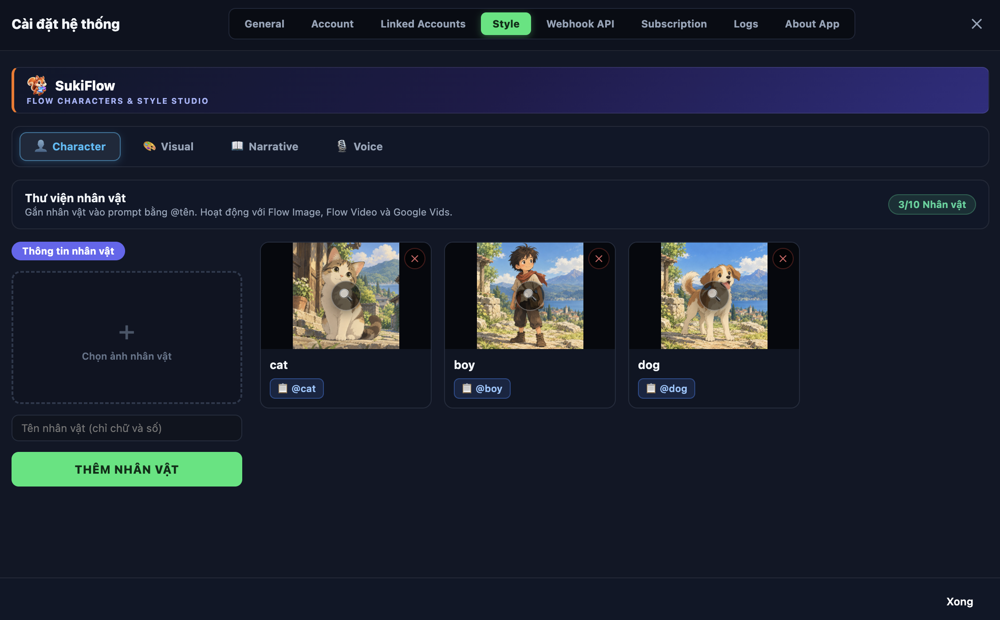

### Visual

Lưu các preset phong cách hình ảnh để áp dụng lại cho nhiều dự án và prompt.

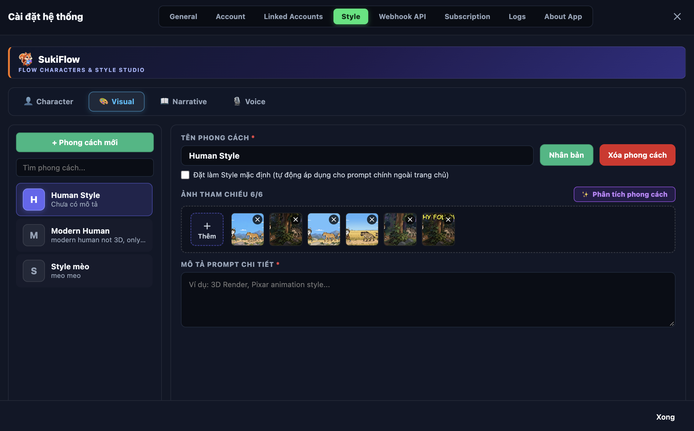

### Narrative

Lưu phong cách kể chuyện, cấu trúc nội dung và chỉ dẫn giọng văn cho Auto Flow.

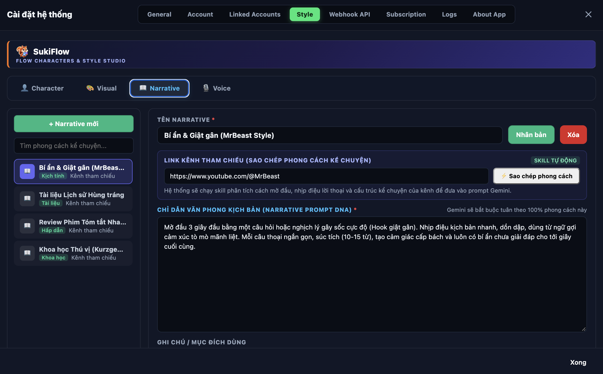

### Voice

Quản lý các preset giọng đọc, voice ID và cấu hình tốc độ để tái sử dụng trong quá trình dựng video.

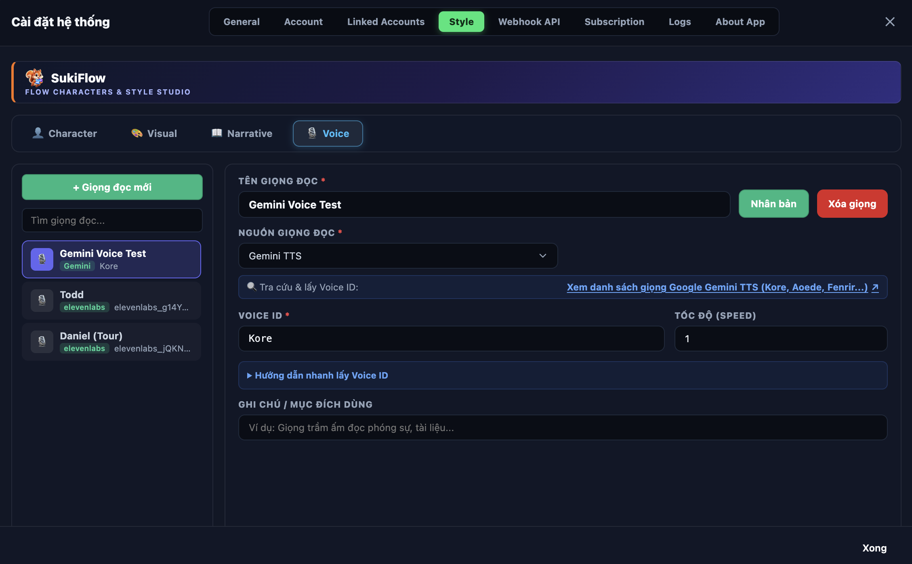

---

## Dữ liệu và quyền riêng tư

- SukiFlow là ứng dụng desktop; file ảnh, video và dữ liệu dự án được lưu trên máy theo thư mục bạn chọn.
- Phiên đăng nhập của từng nền tảng được lưu trong vùng dữ liệu ứng dụng để không phải đăng nhập lại mỗi lần mở app.
- Đăng xuất thiết bị trong SukiFlow không đồng nghĩa với việc xóa toàn bộ Linked Accounts; bạn có thể quản lý hoặc xóa từng tài khoản trong **Setting → Linked Accounts**.
- Không chia sẻ API Key, cookie, profile trình duyệt hoặc thư mục dữ liệu ứng dụng cho người khác.
- SukiFlow dùng trình duyệt để làm việc với các nền tảng bên thứ ba. Bạn chịu trách nhiệm tuân thủ điều khoản và chính sách của các nền tảng tương ứng.

### Thư mục đầu ra mặc định

Các module có thể dùng thư mục mặc định sau nếu bạn không chọn thư mục khác:

| Module | Thư mục thường dùng |
|---|---|
| Google Flow Image/Video | `Pictures/GoogleFlow_Output` |
| Google Pics | `Pictures/GooglePics_Output` |
| Auto Flow | `Pictures/AutoFlow_Output` |

---

## Khắc phục sự cố

### Trạng thái kết nối không chuyển sang hoạt động

- Khi chưa có tác vụ, SukiFlow có thể không hiển thị nhãn trạng thái.
- Khi bắt đầu worker, trạng thái chuyển thành **Kết nối ...**.
- Khi worker sẵn sàng, trạng thái hiển thị số kết nối đang hoạt động.
- Không đóng cửa sổ trình duyệt mà SukiFlow mở trong lúc tác vụ đang chạy.

### Chưa có Linked Account

Vào **Setting → Linked Accounts**, chọn đúng dịch vụ rồi thêm tài khoản. Tài khoản Google Flow không tự thay thế cho Google Vids, Google Pics hoặc Muse AI.

### Cài đè trên Windows báo “Access is denied”

Đóng hoàn toàn SukiFlow và các cửa sổ trình duyệt/terminal liên quan, sau đó chạy lại installer. Không chọn **Skip this file**, vì có thể tạo bản cài thiếu file.

### Tác vụ tạo ảnh hoặc video phản hồi chậm

- Kiểm tra trình duyệt tự động còn mở và tài khoản còn đăng nhập.
- Kiểm tra hạn mức/credit và cảnh báo của nền tảng.
- Giảm số hàng chạy đồng thời xuống 1 để kiểm tra.
- Thử chạy lại một prompt ngắn, không có ảnh tham chiếu.
- Mở **Setting → Logs** và lưu lại log trước khi yêu cầu hỗ trợ.

### Xử lý watermark bị chậm hoặc không hoàn tất

Tính năng này cần model đi kèm và tài nguyên xử lý cục bộ. Hãy thử tắt lựa chọn xử lý watermark để xác nhận luồng tạo ảnh/video chính vẫn hoạt động. Hiệu năng có thể khác nhau theo kiến trúc CPU và cấu hình máy.

### Muse AI không hoạt động

Muse AI có thể giới hạn theo tài khoản hoặc khu vực. Đây không nhất thiết là lỗi cài đặt của SukiFlow.

---

## Cập nhật

SukiFlow kiểm tra chính sách phiên bản khi khởi động. Khi có bản cập nhật bắt buộc, ứng dụng sẽ hiển thị thông báo và đường dẫn tải phiên bản mới.

Luôn tải bản chính thức tại:

**[GitHub Releases — SukiFlow](https://github.com/suki-app/sukiflow-doc/releases/latest)**

---

## Lưu ý

SukiFlow là công cụ hỗ trợ tự động hoá quy trình. SukiFlow không thuộc, không được tài trợ và không được xác nhận bởi Google, Meta, Pexels, Pixabay hoặc các nền tảng bên thứ ba được nhắc đến. Tên thương hiệu thuộc về chủ sở hữu tương ứng.

<p align="center">
  <br>
  <strong>SukiFlow 1.0.0</strong><br>
  © 2026 SukiFlow
</p>
