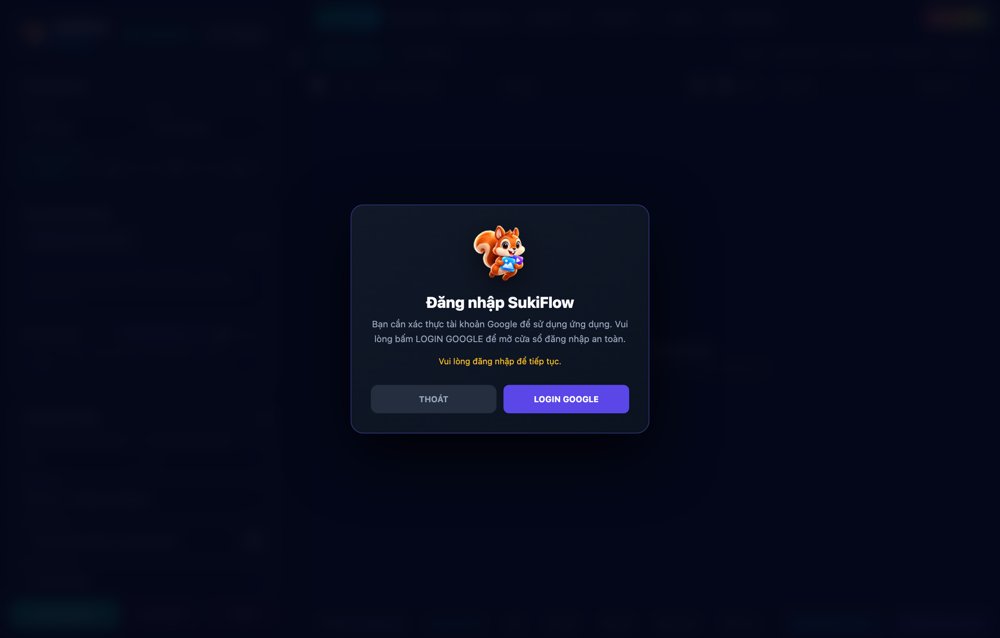

<p align="center">
  
</p>

<h1 align="center">SukiFlow</h1>

<p align="center">
  <strong>The ultimate desktop solution for automating high-volume AI image and video creation across top platforms.</strong>
</p>

<table align="center">
  <tr>
    <td align="center" width="260">
      <br>
      <strong>SukiFlow for Windows</strong><br>
      <sub>64-bit · EXE installer</sub><br><br>
      <a href="https://github.com/suki-app/sukiflow-doc/releases/download/v2.0.0/SukiFlow_Setup_v2.0.0.exe"></a>
    </td>
    <td align="center" width="260">
      <br>
      <strong>SukiFlow for Mac</strong><br>
      <sub>M1 · M2 · M3 · M4</sub><br><br>
      <a href="https://github.com/suki-app/sukiflow-doc/releases/download/v2.0.0/SukiFlow_macOS_v2.0.0_arm64.dmg"></a>
    </td>
    <td align="center" width="260">
      <br>
      <strong>SukiFlow for Mac</strong><br>
      <sub>Intel · x86_64</sub><br><br>
      
    </td>
  </tr>
</table>

<p align="center">
  <a href="README.md">Tiếng Việt</a>
  ·
  <a href="https://github.com/suki-app/sukiflow-doc/releases/latest">Latest release</a>
  ·
  <a href="#installation">Installation</a>
  ·
  <a href="#proxy-management--ip-rotation-proxy-hub">Proxy Hub</a>
  ·
  <a href="#pricing--subscription-plans">Pricing &amp; Plans</a>
  ·
  <a href="#affiliate--referral-program">Affiliate Program</a>
  ·
  <a href="WEBHOOK_API.md">Webhook API Documentation</a>
</p>

> Current version: **SukiFlow v2.0.0**. SukiFlow is a desktop application for Windows and macOS. Features that depend on third-party services may vary by account, region, quota, availability, and each platform's policies.

---

## Overview

SukiFlow brings multiple cutting-edge AI image and video workflows into one desktop application. It supports batch prompts, multi-account management, dedicated proxy and IPv6 assignment per profile, concurrent multi-threading queues, saved sessions, reusable creative presets, direct transfer of results between tools without manual file organization, and programmatic integration via a built-in REST Webhook API server.

### Main capabilities include:

- **Google Flow:** Batch image and video generation through Flow Image (Nano Banana 2/Pro, 1K/2K/4K, 4-column preview grid) and Flow Video (Omni Flash 360p/720p, Veo 3.1, Frames mode &amp; Reference image Ingredients mode, automatic fallback to Google Vids, auto-disable Agent mode, auto-click Google sign-in).
- **Grok AI Studio:** Photorealistic image and video generation powered by Grok, offering uncensored creative freedom, customizable aspect ratios, and styles.
- **ChatGPT Image:** Generate images via ChatGPT supporting both Text-to-Image and Image-to-Image modes (up to 5 reference images), quality presets, and custom style prompts.
- **Muse AI:** Browser-assisted video creation (16:9, 9:16, 5–10s, MP4/WebM/MOV) and image generation with up to 5 reference images, routing through dedicated proxies.
- **Google Vids:** Create videos (3–15s, 16:9/9:16/1:1, up to 3 reference images) and generate Vids Images across rich style presets.
- **Google Pics:** High-resolution batch image generation with original, 2K, or 4K export, character auto-assignment, and reference images.
- **Auto Flow (Video Builder):** Build complete videos from images (Montage), merge video clips, generate Stock Video from scripts (Pexels/Pixabay), Draw Video, and Jetlag Video.
- **Proxy Hub (IPv6 &amp; External Proxy):** Automatically generate and assign individual public IPv6 addresses from your machine's local `/64` subnet or attach external HTTP/SOCKS5 proxies per account to prevent rate limits and IP bans.
- **Plans &amp; Instant Subscriptions:** Clearly defined Basic (Free), Pro, and Ultra tiers with automatic VietQR PayOS activation in seconds.
- **Special Gift for ULTRA Subscribers:** Free **SukiMail license gift code** (worth 100,000 VND/month) for bulk email inbox warming, live-checking, and OTP verification.
- **Affiliate &amp; Referral Program:** Earn recurring passive income by sharing your unique referral link with real-time analytics and fast payouts.
- **Creative Libraries:** Save and reuse Character (`@Name`), Visual, Narrative, and Voice presets across workflows.
- **Built-in Webhook API &amp; Test Playground:** Independent REST Webhook API server (port 10790) coupled with an interactive `/webhook-test` playground for n8n, Make, Zapier, Python, and backend automations.
- **Smart Task Management:** Run immediately, run selected rows, retry failures, FIFO queue scheduling, backoff protection, and previous session restoration.



## Contents

- [Installation](#installation)
- [Getting started](#getting-started)
- [Proxy Management &amp; IP Rotation (Proxy Hub)](#proxy-management--ip-rotation-proxy-hub)
- [Pricing &amp; Subscription Plans](#pricing--subscription-plans)
- [Free SukiMail License Gift for ULTRA](#free-sukimail-license-gift-for-ultra)
- [Affiliate &amp; Referral Program](#affiliate--referral-program)
- [Google Flow](#google-flow)
- [Grok AI Studio](#grok-ai-studio)
- [ChatGPT Image](#chatgpt-image)
- [Muse AI](#muse-ai)
- [Google Vids](#google-vids)
- [Google Pics](#google-pics)
- [Auto Flow (Video Builder)](#auto-flow-video-builder)
- [Creative Libraries](#creative-libraries-character-visual-narrative-and-voice)
- [Webhook API Server](#webhook-api-server)
- [Data and privacy](#data-and-privacy)
- [Troubleshooting](#troubleshooting)

---

## Installation

### System requirements

| Platform | Recommended version | Installer |
|---|---|---|
| Windows | Windows 10/11 64-bit | `SukiFlow_Setup_v2.0.0.exe` |
| macOS Apple Silicon | macOS 12 or later | `SukiFlow_macOS_v2.0.0_arm64.dmg` |
| macOS Intel | Demo build in progress | Coming soon |

Official installers include all required runtime components. End users do not need to install Python or FFmpeg separately.

### Windows

1. Download **SukiFlow Setup** using the button at the top of this page.
2. Close any running SukiFlow instance before installing or updating.
3. Open `SukiFlow_Setup_v2.0.0.exe` and complete the installation.
4. Launch SukiFlow from the Start Menu or Desktop shortcut.
5. If Windows SmartScreen appears, select **More info** → **Run anyway**. Only install packages downloaded from this official Releases page.

### macOS

1. Download `SukiFlow_macOS_v2.0.0_arm64.dmg`.
2. Open the DMG file and drag **SukiFlow.app** into the **Applications** folder.
3. On first launch, right-click SukiFlow → **Open** → **Open**.
4. If macOS still blocks the app, go to **System Settings → Privacy & Security** and select **Open Anyway** for SukiFlow.

If macOS flags the application as quarantined, you can run:

```bash
xattr -dr com.apple.quarantine "/Applications/SukiFlow.app"
```

> The macOS build is currently released for Apple Silicon (`arm64`). Check your chip type under **Apple menu → About This Mac** before downloading.

---

## Getting started

1. Launch SukiFlow and click **LOGIN GOOGLE** to authenticate your SukiFlow profile.
2. Navigate to **Setting → Linked Accounts**.
3. Select the desired service and click **Add Account**:
   - Google Flow
   - Muse AI
   - ChatGPT
   - Grok AI
   - Google Vids
   - Google Pics
4. An automated browser window will open. For Google Flow, SukiFlow automatically clicks the landing page button to take you directly to the Google Account sign-in screen. Sign in to your account and wait a few moments for session verification.
5. *(Optional)* Click **🌐 Proxy Management** to assign a dedicated IPv6 or external proxy to each profile.
6. Return to your desired tab, enter prompts, and click **Run now**.

> When SukiFlow is actively generating images or videos, do not close the automated browser windows. These sessions execute tasks and stream results back to the desktop app.

---

## Proxy Management & IP Rotation (Proxy Hub)

Running multiple AI accounts on the same machine through a single public IP address often triggers security checkpoints, rate limits, or account suspensions from providers like Google, OpenAI, and Muse.

SukiFlow 2.0 introduces the **Proxy Hub** directly integrated into the Linked Accounts manager:

### 1. Automatic Local IPv6 Pool
- **How it works:** SukiFlow detects your provider's local `/64` IPv6 subnet, extracts dozens of unique, routable public IPv6 addresses, and launches a local ultra-low latency proxy daemon.
- **Dedicated IP Per Profile:** Each account (Google Flow, Muse AI, ChatGPT...) is assigned its own local port (`:28001`, `:28002`, `:28003`...), binding all outgoing browser traffic to a distinct public IPv6.
- **Zero Additional Cost:** Leverages your existing ISP connection without needing expensive monthly proxy subscriptions.
- **1-Click Controls:**
  - `⚡ Auto-assign All`: Automatically assigns available IPv6 addresses to all unassigned accounts.
  - `Change`: Instantly switches to a fresh IPv6 from the pool in 1 second.
  - `Test`: Tests connection speed and displays the exact external IP seen by destination servers.
  - `Remove`: Reverts the account to your default network connection.

### 2. External Custom Proxies (HTTP / SOCKS5)
- Supports external residential, datacenter, or mobile proxies using `HTTP`, `HTTPS`, or `SOCKS5`.
- Accepts standard formats:
  - `IP:Port` (IP-whitelisted proxies)
  - `IP:Port:Username:Password` (Authenticated proxies)
- Assign proxies individually per profile or paste a batch list for automatic round-robin distribution.
- Hardened browser contexts conceal automation flags (`navigator.webdriver`).

---

## Pricing & Subscription Plans

SukiFlow offers clear, scalable tiers suitable for hobbyists, power creators, and high-volume media studios:

| Feature | BASIC PLAN | PRO PLAN 🔥 | ULTRA PLAN 👑 |
| :--- | :---: | :---: | :---: |
| **Price (Monthly)** | **Free forever** ($0) | **79,000 VND** *(reg. 100k)* | **149,000 VND** *(reg. 200k)* |
| **Linked Accounts Limit** | **5** accounts (total app-wide) | **10** accounts | **100** accounts |
| **Concurrency (Parallel Threads)** | 1 thread | **4 parallel threads** | **4 parallel threads** |
| **Prompt Limit** | 5 prompts / batch run | **Unlimited** | **Unlimited** |
| **Available Services** | Google Flow, Muse AI | **Unlock All** (Flow, Muse, ChatGPT, Grok, Vids, Pics) | **Unlock All** services |
| **Image Export Quality** | 1K | **2K / 4K Ultra HD** | **2K / 4K Ultra HD** |
| **Auto Watermark / Logo Cleaner** | ✕ | **Included** | **Included** |
| **Automatic Model Fallback** | ✕ | **Included** (Flow → Vids) | **Included** |
| **REST Webhook API Server** | ✕ | ✕ | **ULTRA Exclusive** |
| **Free SukiMail License Gift** | ✕ | ✕ | **🎁 Free SukiMail Code (100k/mo value)** |
| **Support** | Community | Priority | **VIP 1-on-1 Direct Support** |

### Billing Cycle Discounts
- **6-Month Plan:** Save an extra **10%** off the total invoice.
- **1-Year Plan:** Save up to **20%** off the total invoice.

### Instant VietQR PayOS Activation
- Select your plan and billing term to generate a dynamic VietQR code.
- Scan with any banking or e-wallet app; the system **activates your plan automatically within 3–5 seconds**.
- Pro-rata credit rollover: When upgrading from PRO to ULTRA, your remaining PRO balance is converted into extra ULTRA subscription days.

---

## Free SukiMail License Gift for ULTRA

Every **SukiFlow ULTRA** subscriber receives an exclusive gift:

> 🎁 **FREE SUKIMAIL LICENSE KEY (WORTH 100,000 VND / ~$4 USD PER MONTH)**

### What is SukiMail?
[SukiMail](https://github.com/suki-app) is a dedicated desktop application engineered for bulk inbox warming, automated email validation, and credential security:
- Real-time live/dead mailbox health verification for thousands of addresses.
- Auto-fetches OTP codes and account verification links instantly.
- Keeps accounts warm to prevent dormancy bans.
- The perfect companion software for provisioning and maintaining Google Flow, Muse AI, and ChatGPT accounts.

### How to claim:
Upon completing your ULTRA upgrade, your SukiMail gift code appears immediately in **Settings → Subscription**. Click the **Copy** 📋 button and paste it into SukiMail to unlock full premium features at no cost.

---

## Affiliate & Referral Program

Earn sustainable recurring passive income with the SukiFlow Affiliate Partner Program:

### Partner Benefits:
- **Unique Referral Link & Code:** Every logged-in user receives a unique referral code and tracking link.
- **Recurring Commissions:** Earn direct commission percentages whenever referred users purchase or renew PRO or ULTRA subscriptions.
- **Real-Time Analytics Dashboard:**
  - Track total registered referrals.
  - Monitor accumulated earnings and available balance.
  - Transparent transaction histories.
- **Fast Payouts:** Withdraw earned commissions directly to your local bank account with minimal thresholds.

Access the affiliate dashboard by clicking the **Gift box icon** 🎁 next to your plan badge in the top-left corner, or via **Settings → Subscription → Referral Program**.

---

## Google Flow

### Flow Image

Flow Image provides high-performance batch image creation:

- Aspect ratios: `16:9`, `9:16`, `1:1`, `4:3`, `3:4`.
- Models: **Nano Banana 2**, **Nano Banana 2 Lite**, and **Nano Banana Pro**.
- Generates 1 to 4 images per prompt.
- Export resolutions: **1K**, **2K**, or **4K**.
- Responsive **4-column preview grid**.
- Up to 4 concurrent execution threads with configurable delay intervals between rows.
- Enter prompts directly or import from TXT, CSV, or XLSX files.
- Auto-attach character reference images using `@CharacterName` tags.
- Automatic Model Fallback during temporary provider outages.
- Built-in watermark cleaning.
- 1-click transfer to Flow Video or Auto Flow.

### Flow Video

Flow Video offers cutting-edge AI video generation:

- **Diverse Model Support:**
  - **Omni 1.1 Flash:** Resolutions in **360p** and **720p**, flexible durations: **4s, 6s, 8s, 10s**.
  - **Veo 3.1 (Lite, Fast, Quality):** 8-second cinematic video generation.
- **Aspect ratios:** `16:9` (Landscape) and `9:16` (Portrait).
- **2 Image-to-Video Modes:**
  1. **Frames mode:** Seamless camera and subject motion interpolation from Start frame to End frame.
  2. **Ingredients / Reference mode (R2V):** Upload up to **3 reference images** to guide characters (`@Image1`, `@Image2`), artistic styles, or scenery.
- **Auto Fallback to Google Vids:** When Flow encounters quota exhaustion, prompts and reference assets seamlessly route to Google Vids to ensure uninterrupted batch production.
- **SukiFlow 2.0 Smart Automations:**
  - Automatically turns off `Flow Agent mode` toggle to prevent prompt syntax rejections.
  - Automatically dismisses onboarding carousel popups.
  - Automatically clicks `Create with Google Flow` to open Google's login form immediately upon adding an account.

---

## Grok AI Studio

Grok AI Studio brings the power of xAI's Grok model into your automated workflow:

- Generates photorealistic visuals with high creative freedom and relaxed content filters.
- Supports pure text-to-image and reference-guided synthesis.
- Multi-threaded execution across multiple linked Grok profiles.
- Automatic image detection and local file download.

---

## ChatGPT Image

Direct integration with ChatGPT image generation capabilities:

- **2 Execution Modes:**
  - **Text-to-Image:** Detailed photorealistic images from textual descriptions.
  - **Image-to-Image:** Transform existing images guided by up to **5 reference images**.
- **Quality Presets:** `auto`, `high`, `medium`, `low`.
- **Aspect Ratios:** `16:9`, `1:1`, `3:2`, `2:3`, `9:16`.
- Generates 1 to 4 images per prompt with customizable delays to bypass rate limiting.
- Append custom aesthetics using the **Style prompt** field.

---

## Muse AI

Muse AI produces both videos and images via automated browser control:

- **Muse AI Video:** Aspect ratios `16:9` or `9:16`, 5s–10s durations, exports to **MP4**, **WebM**, or **MOV**. Accepts up to **5 reference images**.
- **Muse AI Image:** High-fidelity images from text prompts or up to **5 reference images**.
- **Integrated Proxy Support:** Assign local IPv6 or external proxies per Muse account to prevent geographic network blocking.
- Custom execution timeouts from 60s to 900s for complex generations.

---

## Google Vids

Google Vids combines Video and Image creation in one workspace:

### Vids Video
- Generate videos from text or up to **3 reference images**.
- Durations: **3, 4, 5, 6, 8, 10, 12, or 15 seconds** (default: 5s).
- Aspect ratios: `16:9`, `9:16`, and `1:1`.
- Resolutions: **720p** or **1080p**.
- Character auto-tagging via `@CharacterName`.
- Direct transfer of finished clips into Auto Flow.

### Vids Image
- Rich artistic presets: *Photography, Vector art, Sketch, Watercolor, Cyberpunk, Background, etc.*
- Aspect ratios: `16:9`, `9:16`, `1:1`.
- Reference image attachment and character assignment.

---

## Google Pics

Independent batch image synthesis workflow:

- Aspect ratios: `16:9`, `9:16`, `1:1`, `4:3`, `3:4`.
- Export options: **Original**, **2K JPEG**, or **4K JPEG**.
- Up to 4 images per prompt with character recognition.
- Accepts up to 3 reference images per item.
- Queue scheduling, automatic failure retries, and past session restoration.

---

## Auto Flow (Video Builder)

Auto Flow is an automated post-production suite assembling images, video clips, AI voices, and background soundtracks into finished videos for YouTube, TikTok, and Facebook Reels.

1. **Image to Video (Montage):** Builds cohesive videos from image folders, applies Ken Burns camera movements, AI narration, and synchronized subtitles.
2. **Videos to Video:** Stitches short video clips into long-form compilations with audio ducking and background music.
3. **Stock Video:** Generates conceptual outlines, fetches licensed HD footage from **Pexels** / **Pixabay**, and replaces segments with AI generations where needed.
4. **Draw Video:** Creates engaging hand-drawn sketch animation videos from scripts.
5. **Jetlag Video:** Multi-language localized video translation pipeline.

---

## Creative Libraries

- **Character:** Store character reference turnarounds. Type `@CharacterName` in prompts to automatically attach reference photos.
- **Visual:** Save lighting, composition, and aesthetic presets.
- **Narrative:** Store storytelling hooks, script structures, or clone pacing from YouTube/TikTok URLs.
- **Voice:** Manage AI voice IDs, pitch, and speed settings for Auto Flow.

---

## Webhook API Server

SukiFlow includes an independent **REST Webhook API server** (default port `10790`) to integrate SukiFlow with **n8n, Make.com, Zapier**, Python scripts, or custom backends:

- **Secure `X-API-Key` Authentication:** All media endpoints require token validation.
- **Network Binding:** Bind strictly to `127.0.0.1` (localhost) or expose to `0.0.0.0` (LAN).
- **Interactive Playground (`/webhook-test`):** Built-in browser GUI at `http://127.0.0.1:10789/webhook-test` for real-time payload testing.

📖 Read the complete integration guide: **[Webhook API Documentation (WEBHOOK_API.md)](WEBHOOK_API.md)**.

---

## Data and privacy

- SukiFlow operates as a local desktop software. All media assets, prompts, and rendered videos remain on your local storage.
- Platform login sessions and cookies are encrypted and stored in your operating system's application directory.
- Logging out of SukiFlow does not erase your Linked Accounts or proxy configurations.
- SukiFlow never transmits credentials or cookies to external servers.

---

## Troubleshooting

### 1. "Account limit reached" notification
- SukiFlow enforces limits based on the **total unique accounts across all services** linked to your machine. For example, 2 Flow + 2 Muse + 1 ChatGPT equals 5 accounts (the Basic plan limit).
- To add more accounts, remove inactive profiles or upgrade to **PRO** (10 accounts) or **ULTRA** (100 accounts).

### 2. Browser stays on the landing page during sign-in
- SukiFlow 2.0 automatically clicks `Create with Google Flow` / `Sign in`. Allow 3–5 seconds for the landing page to load before the Google login screen appears.

### 3. Rate limits or network blocks
- Open **Setting → Linked Accounts → Proxy Hub**.
- Click **⚡ Auto-assign All** to distribute free local IPv6 addresses to each account, or configure external HTTP/SOCKS5 proxies.

### 4. Windows installer reports “Access is denied”
- Completely close SukiFlow (verify via Task Manager that no background worker is running), then rerun the installer.

---

## Updates

SukiFlow checks for updates upon launch. Always download releases from:

**[GitHub Releases — SukiFlow](https://github.com/suki-app/sukiflow-doc/releases/latest)**

---

## Disclaimer

SukiFlow is an automation tool designed to streamline creative workflows. SukiFlow is not affiliated with, endorsed by, or sponsored by Google, OpenAI, xAI, Meta, Pexels, Pixabay, or any third-party services mentioned. All brand names belong to their respective owners.

<p align="center">
  <br>
  <strong>SukiFlow v2.0.0</strong><br>
  © 2026 SukiFlow
</p>
