<p align="center">
  
</p>

<h1 align="center">SukiFlow</h1>

<p align="center">
  <strong>A desktop solution for automating high-volume AI image and video creation across multiple platforms.</strong>
</p>

<table align="center">
  <tr>
    <td align="center" width="260">
      <br>
      <strong>SukiFlow for Windows</strong><br>
      <sub>64-bit · EXE installer</sub><br><br>
      <a href="https://github.com/suki-app/sukiflow-doc/releases/download/v1.2.0/SukiFlow_Setup_v1.2.0.exe"></a>
    </td>
    <td align="center" width="260">
      <br>
      <strong>SukiFlow for Mac</strong><br>
      <sub>M1 · M2 · M3 · M4</sub><br><br>
      <a href="https://github.com/suki-app/sukiflow-doc/releases/download/v1.2.0/SukiFlow_macOS_v1.2.0_arm64.dmg"></a>
    </td>
    <td align="center" width="260">
      <br>
      <strong>SukiFlow for Mac</strong><br>
      <sub>Intel · x86_64</sub><br><br>
      
    </td>
  </tr>
</table>

<p align="center">
  <a href="README.md">Tiếng Việt</a>
  ·
  <a href="https://github.com/suki-app/sukiflow-doc/releases/latest">Latest release</a>
  ·
  <a href="#installation">Installation</a>
  ·
  <a href="WEBHOOK_API.md">Webhook API Documentation</a>
  ·
  <a href="#troubleshooting">Troubleshooting</a>
</p>

> Current version: **SukiFlow 1.2.0**. SukiFlow is a desktop application for Windows and macOS. Features that depend on third-party services may vary by account, region, quota, availability, and each platform's policies.

---

## Overview

SukiFlow brings multiple cutting-edge AI image and video workflows into one desktop application. It supports batch prompts, multiple linked accounts, concurrent task queues, saved sessions, reusable creative presets, direct transfer of results between tools without manual file management, and programmatic integration via a built-in REST Webhook API server.

Main capabilities include:

- **Google Flow:** Batch image and video generation through Flow Image (Nano Banana 2/Pro, 1K/2K/4K, 4-column preview grid) and Flow Video (Omni Flash 360p/720p, Veo 3.1, Frames mode &amp; Reference image Ingredients mode, automatic fallback to Google Vids).
- **Google Vids:** Create videos (3–15s, 16:9/9:16/1:1, up to 3 reference images) and generate Vids Images across rich style presets.
- **Google Pics:** High-resolution batch image generation with original, 2K, or 4K export, character auto-assignment, and reference images.
- **ChatGPT Image:** Generate images via ChatGPT supporting both Text-to-Image and Image-to-Image modes (up to 5 reference images), quality presets, and custom style prompts.
- **Muse AI:** Browser-assisted video creation (16:9, 9:16, 5–10s, MP4/WebM/MOV) and image generation with up to 5 reference images.
- **Auto Flow (Video Builder):** Build complete videos from images, merge video clips, generate Stock Video from script, Draw Video, and Jetflag Video.
- **Linked Accounts:** Independently manage and auto-rotate Google Flow, Google Vids, Google Pics, and Muse AI sessions.
- **Creative Libraries:** Save and reuse Character, Visual, Narrative, and Voice presets across workflows.
- **Built-in Webhook API &amp; Test Playground:** Independent REST Webhook API server (port 10790) coupled with an interactive `/webhook-test` playground for n8n, Make, Zapier, Python, and backend automations.
- **Smart Task Management:** Run immediately, run selected rows, retry failures, FIFO queue scheduling, backoff protection, and previous session restoration.

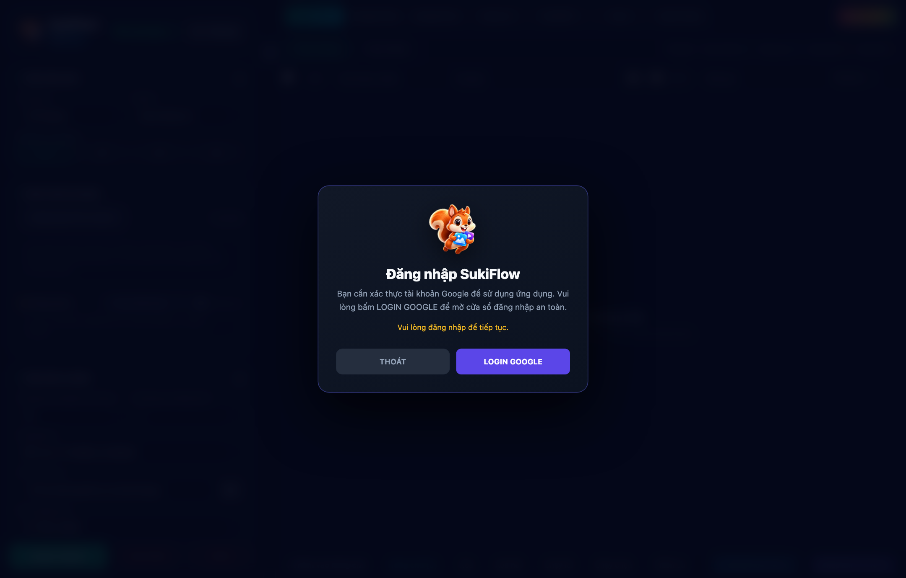

## Contents

- [Installation](#installation)
- [Getting started](#getting-started)
- [Google Flow](#google-flow)
- [Google Vids](#google-vids)
- [Google Pics](#google-pics)
- [ChatGPT Image](#chatgpt-image)
- [Muse AI](#muse-ai)
- [Auto Flow (Video Builder)](#auto-flow-video-builder)
- [Creative Libraries](#creative-libraries-character-visual-narrative-and-voice)
- [Webhook API Server](#webhook-api-server)
- [Data and privacy](#data-and-privacy)
- [Troubleshooting](#troubleshooting)

---

## Installation

### System requirements

| Platform | Recommended version | Installer |
|---|---|---|
| Windows | Windows 10/11 64-bit | `SukiFlow_Setup_v1.2.0.exe` |
| macOS Apple Silicon | macOS 12 or later | `SukiFlow_macOS_v1.2.0_arm64.dmg` |
| macOS Intel | Demo build in progress | Coming soon |

Official installers include all required runtime components. End users do not need to install Python or FFmpeg separately.

### Windows

1. Download **SukiFlow Setup** using the button at the top of this page.
2. Close any running SukiFlow instance before installing or updating.
3. Open `SukiFlow_Setup_v1.2.0.exe` and complete the installation.
4. Launch SukiFlow from the Start Menu or Desktop shortcut.
5. If Windows SmartScreen appears, select **More info** → **Run anyway**. Only install packages downloaded from this official Releases page.

### macOS

1. Download `SukiFlow_macOS_v1.2.0_arm64.dmg`.
2. Open the DMG file and drag **SukiFlow.app** into the **Applications** folder.
3. On first launch, right-click SukiFlow → **Open** → **Open**.
4. If macOS still blocks the app, go to **System Settings → Privacy & Security** and select **Open Anyway** for SukiFlow.

If macOS flags the application as quarantined, you can run:

```bash
xattr -dr com.apple.quarantine "/Applications/SukiFlow.app"
```

> The macOS build is currently released for Apple Silicon (`arm64`). Check your chip type under **Apple menu → About This Mac** before downloading.

---

## Getting started

1. Launch SukiFlow and click **LOGIN GOOGLE** to authenticate your SukiFlow profile.
2. Navigate to **Setting → Linked Accounts**.
3. Select the desired service and click **Add Account**:
   - Google Flow
   - Google Vids
   - Google Pics
   - Muse AI
4. Complete login inside the browser window opened by SukiFlow.
5. Return to the main tab, enter your prompts, and click **Run now**.

> When SukiFlow is actively generating images or videos via Google Flow, Google Vids, or Google Pics, do not close the automated browser windows. These sessions execute tasks and stream results back to the desktop app.

If no active account is detected, SukiFlow displays an informative prompt and guides you directly to the Linked Accounts tab.

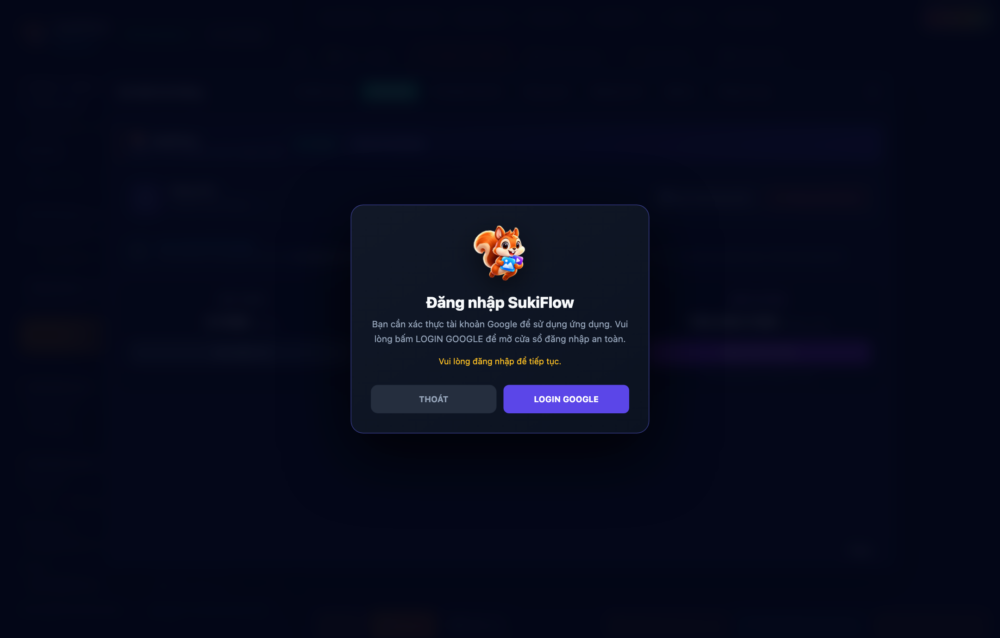

---

## Google Flow

### Flow Image

Flow Image provides high-performance batch image creation:

- Aspect ratios: `16:9`, `9:16`, `1:1`, `4:3`, `3:4`.
- Models: **Nano Banana 2**, **Nano Banana 2 Lite**, and **Nano Banana Pro**.
- Generate 1 to 4 images per prompt.
- Export resolutions: **1K**, **2K**, or **4K**.
- Clean **4 images per row** preview grid for fast visual review.
- Run up to 4 concurrent rows with customizable inter-row delays.
- Input prompts directly or import from TXT, CSV, and XLSX.
- Automatically bind character reference images with `@CharacterName` syntax.
- Automatic model fallback to keep batches running when primary models are rate-limited.
- Built-in watermark removal support.
- One-click transfer of completed images to Flow Video or Auto Flow.


### Flow Image Queue

Select one or more prompts to enqueue. Each queued task retains its dedicated configuration and executes in sequence or in parallel according to linked account capacity.

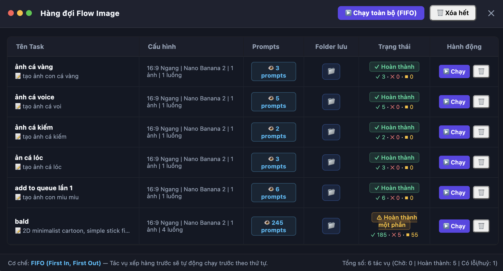

### Flow Video

Flow Video delivers versatile AI video generation with two image-to-video modes:

- **Model selection:**
  - **Omni 1.1 Flash:** Supports **360p** and **720p** resolutions with durations of **4s, 6s, 8s, or 10s**.
  - **Veo 3.1 (Lite, Fast, Quality):** 8-second cinematic video generation.
- **Aspect ratios:** `16:9` (landscape) and `9:16` (portrait).
- **Two flexible Image-to-Video modes:**
  1. **Frames mode:** Seamless transition from a required Start image to an optional End image.
  2. **Ingredients / Reference-to-Video (R2V) mode:** Upload up to **3 reference images** to guide characters (`@Image1`, `@Image2`), scene context, or visual style.
- **Automatic Fallback to Google Vids:** If Google Flow accounts encounter quota limits or connection errors, SukiFlow automatically routes the prompt and reference images to Google Vids to ensure uninterrupted batch completion.
- Watermark cleaning, parallelism control, and customizable output destination.

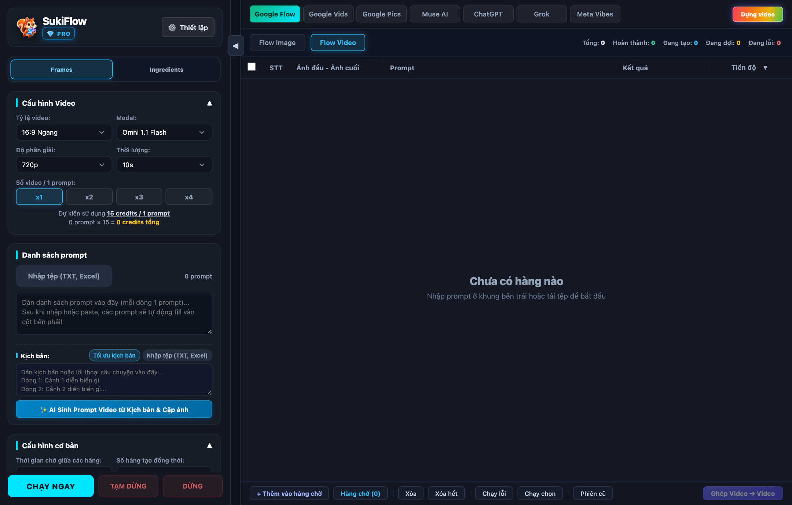

---

## Google Vids

Google Vids brings both video and image generation into a unified workspace:

### Vids Video

- Generate video from text prompts or up to **3 reference images**.
- Flexible duration: **3, 4, 5, 6, 8, 10, 12, or 15 seconds** (default 5s).
- Aspect ratios: `16:9` (landscape), `9:16` (portrait), and `1:1` (square).
- Resolutions: **720p** or **1080p**.
- Auto-assign character references via `@CharacterName`.
- Direct transfer of finished clips into Auto Flow for long-form video composition.

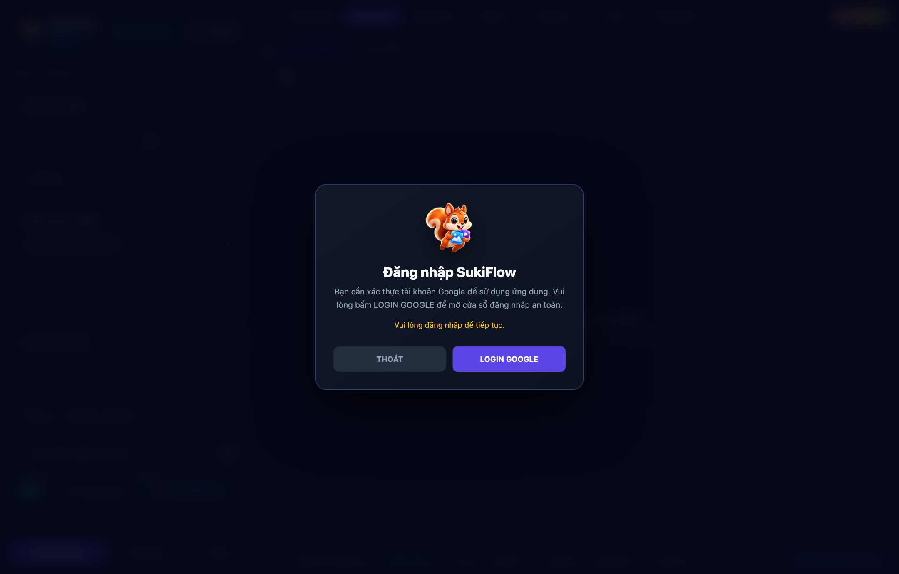

### Vids Image

- Generate single or batch images with rich artistic presets: *Photography, Vector art, Sketch, Watercolor, Cyberpunk, Background, etc.*
- Aspect ratios: `16:9`, `9:16`, `1:1`.
- Full support for reference images and `@CharacterName` tagging.

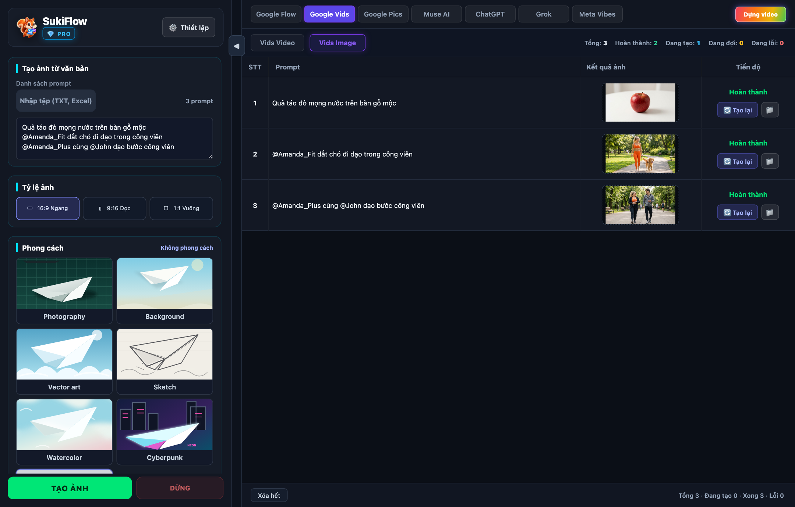

---

## Google Pics

Google Pics offers a dedicated, high-resolution batch image generation pipeline:

- Common aspect ratios: `16:9`, `9:16`, `1:1`, `4:3`, `3:4`.
- Export resolutions: **Original**, **2K JPEG**, or **4K JPEG**.
- Generate up to 4 images per prompt.
- Auto-tagging with `@CharacterName`.
- Up to 3 reference images per task.
- Queue management, automatic error retries, and session restore.

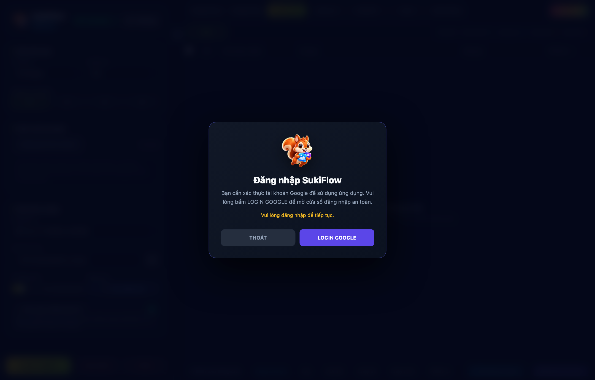

---

## ChatGPT Image

Integrated image generation powered by ChatGPT models:

- **Two operating modes:**
  - **Text-to-Image:** Detailed image creation from rich descriptions.
  - **Image-to-Image:** Image transformation guided by up to **5 reference images**.
- **Quality levels:** `auto`, `high`, `medium`, `low`.
- **Aspect ratios:** `16:9`, `1:1`, `3:2`, `2:3`, `9:16`.
- Generate 1 to 4 images per prompt with configurable inter-image delays (`wait_seconds`) to avoid rate limits.
- Additional styling via the **Style prompt** field.

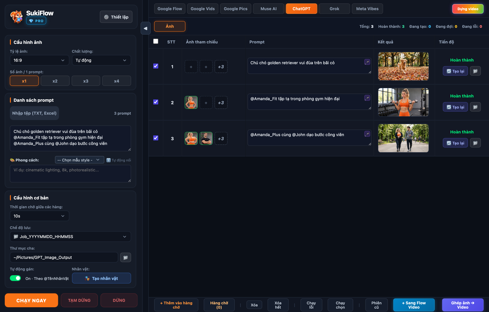

---

## Muse AI

Muse AI generates both video and images through automated browser sessions:

- **Muse AI Video:** Aspect ratios `16:9` or `9:16`, recommended 10s duration (prompt-guided 5s–10s), export format options **MP4**, **WebM**, and **MOV**. Accepts up to **5 reference images**.
- **Muse AI Image:** High-quality image generation with up to **5 reference images**.
- Customizable timeouts (60s to 900s) for complex video generation jobs.

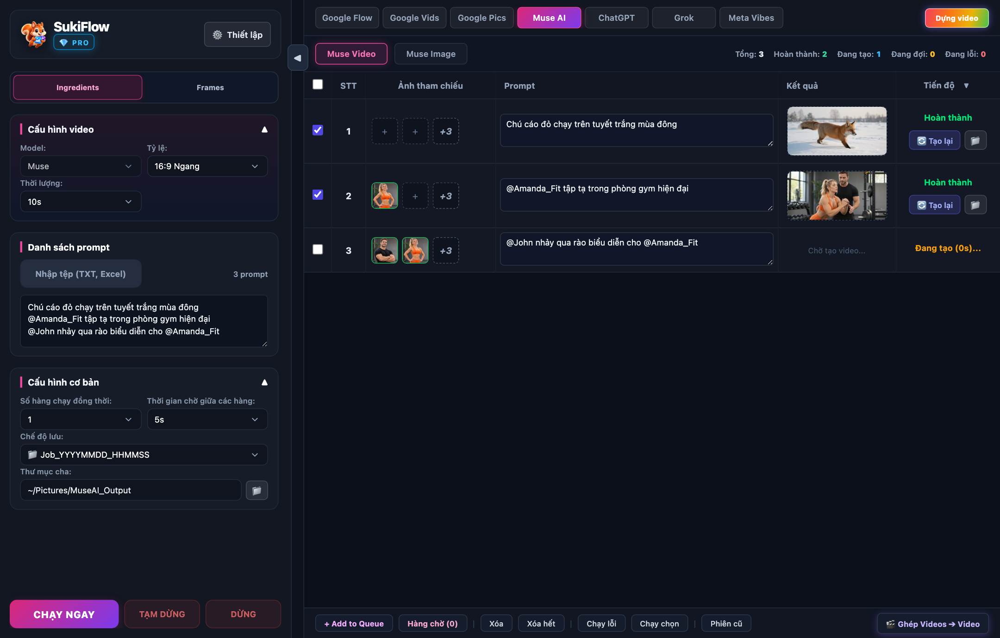

> Muse AI availability may depend on account eligibility and regional network routing per Muse platform policies.

---

## Auto Flow (Video Builder)

Auto Flow is a full-featured video production studio that combines images, video clips, AI voices, and background music into finished videos for YouTube, TikTok, and social media.

### 1. Image → Video (Montage)

- Build finished videos from a folder of images or items transferred from Flow Image / Google Pics.
- Per-scene motion effects, panning, and transition timing.
- Generate AI narration (Gemini, AI33, Edge TTS) or upload voice files.
- Automated timeline alignment, dynamic subtitles, and background audio ducking.

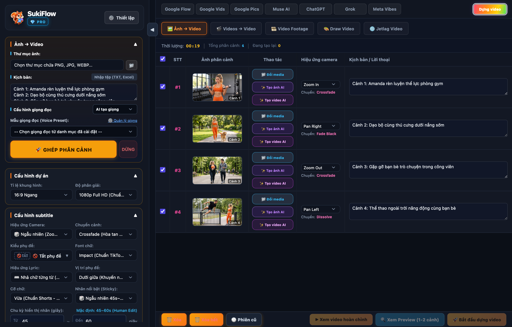

### 2. Videos → Video

- Concatenate and arrange multiple video clips into a single long-form video.
- Reorder scenes, trim clips, toggle original audio, and layer narrator voiceovers.

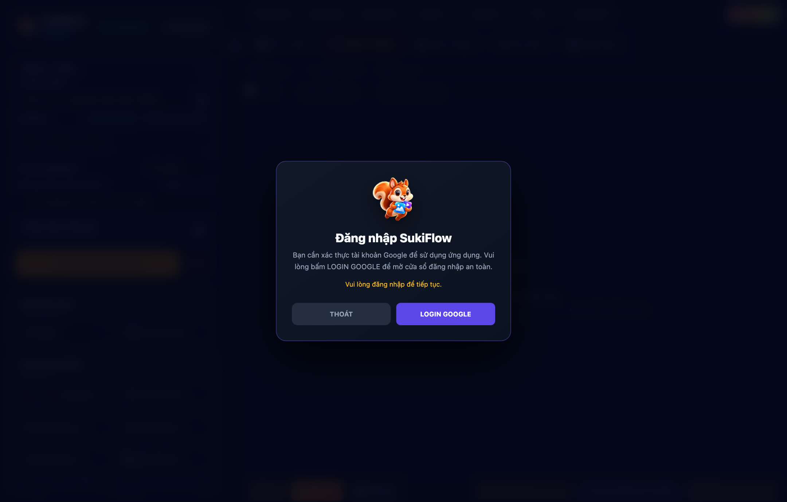

### 3. Stock Video

- Generate storyboard scripts from a topic using AI.
- Automatically query and download matching high-resolution stock clips from **Pexels** and **Pixabay**.
- Selectively convert scenes into AI videos using Google Flow, Google Vids, or Muse AI.
- Export finalized videos complete with voiceover, subtitles, and background audio.


### 4. Draw Video

- Transform scripts or topics into hand-drawn sketch animation videos with synchronized voiceover and music.

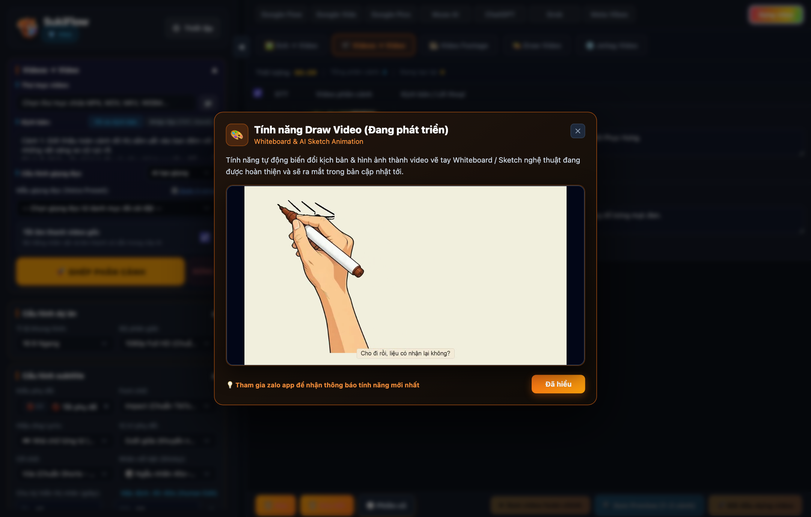

### 5. Jetflag Video

- Video localization pipeline for multi-language and international content adaptation (in active development).

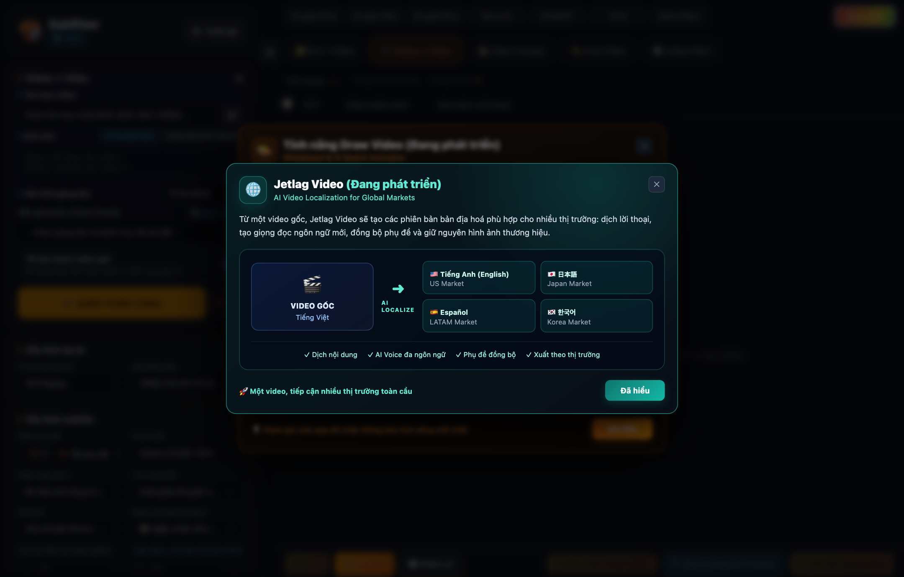

---

## Creative Libraries (Character, Visual, Narrative, and Voice)

### Character

Store character identity descriptions and reference images. Mention `@CharacterName` in any prompt to automatically inject the character's reference images across Flow, Vids, Pics, or ChatGPT.

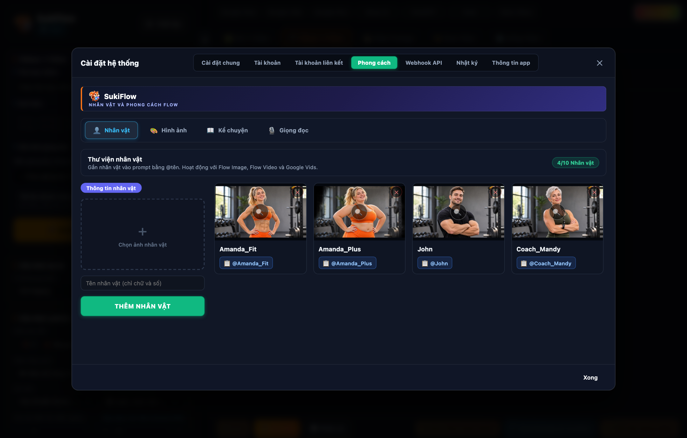

### Visual Style

Save art style presets (lighting, color palette, camera angles) for instant one-click reuse across projects.

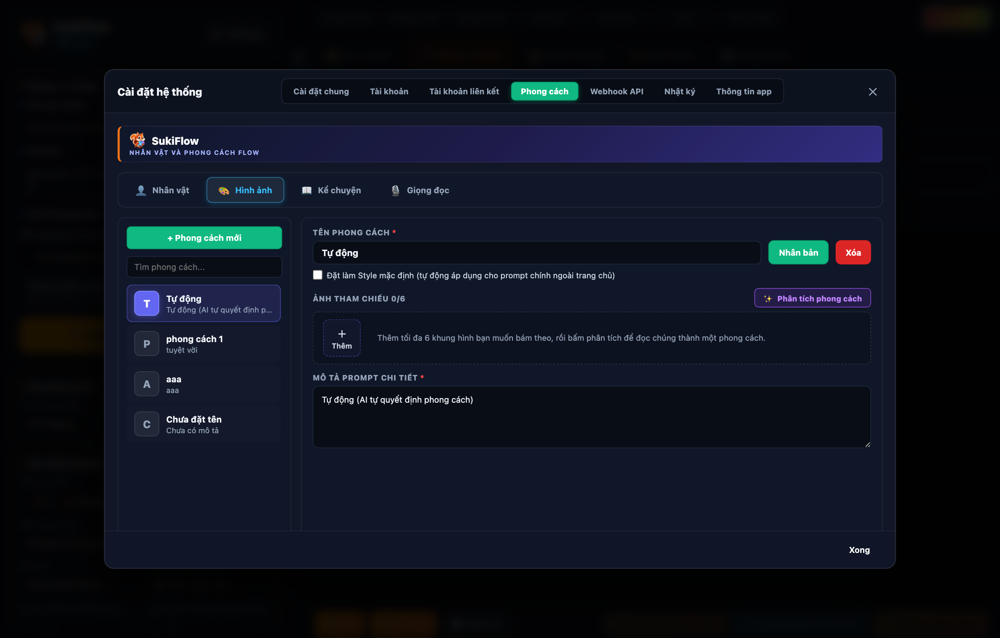

### Narrative Style

Store storytelling DNA (Hook opening, pacing, dialogue structure) or use the **Clone Channel Style** tool to analyze YouTube/TikTok links and have AI write scripts in that specific voice.

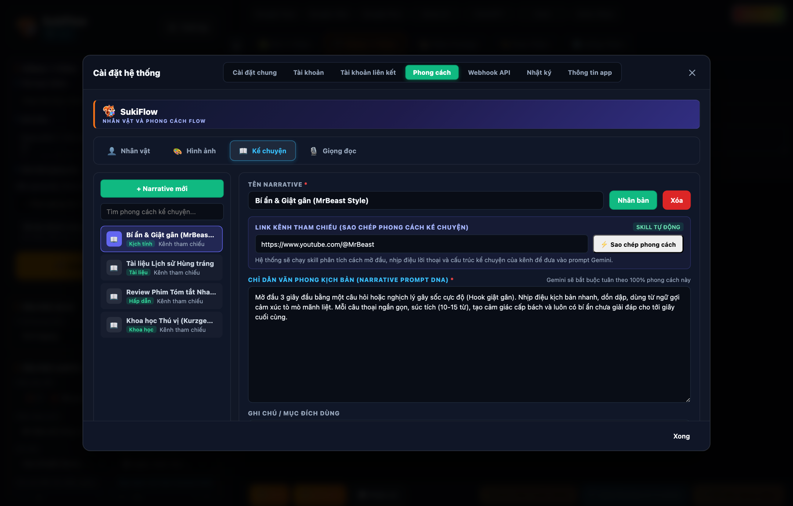

### Voice

Manage AI narrator voices, voice IDs, speed, and pitch settings for consistent audio across all Auto Flow videos.

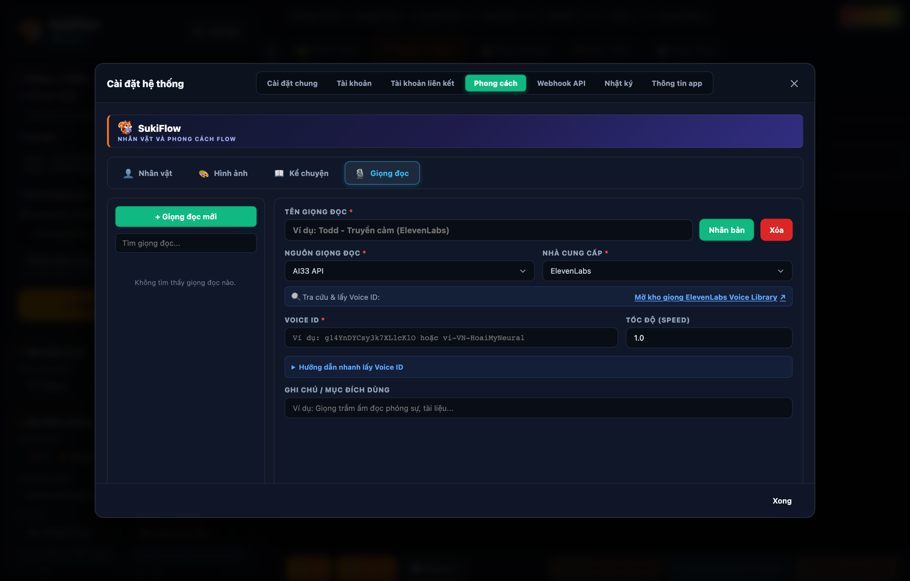

---

## Webhook API Server

SukiFlow 1.2.0 includes an independent, built-in **REST Webhook API server** (default port `10790`), allowing external automation tools like **n8n, Make.com, Zapier**, or custom Python/cURL scripts to trigger image and video generation remotely.

### Webhook API Highlights:

- **API Key Authentication (`X-API-Key`):** Every generation request is authenticated.
- **Flexible Network Binding:** Bind strictly to localhost (`127.0.0.1`) or open to the local network (`0.0.0.0` - LAN) so other devices on the same Wi-Fi/LAN can send jobs.
- **Real-Time Request Logs:** Monitor incoming API calls (HTTP method, route, status code, client IP) directly inside the app settings.
- **Built-in Webhook Test Playground (`/webhook-test`):** Access `http://127.0.0.1:10789/webhook-test` to test every endpoint interactively, inspect JSON payloads and responses, download outputs, and submit batches of up to 100 prompts concurrently.

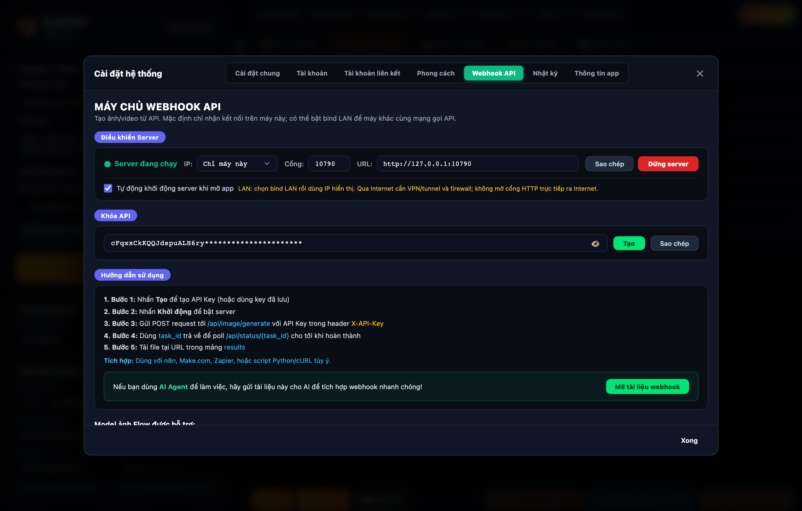

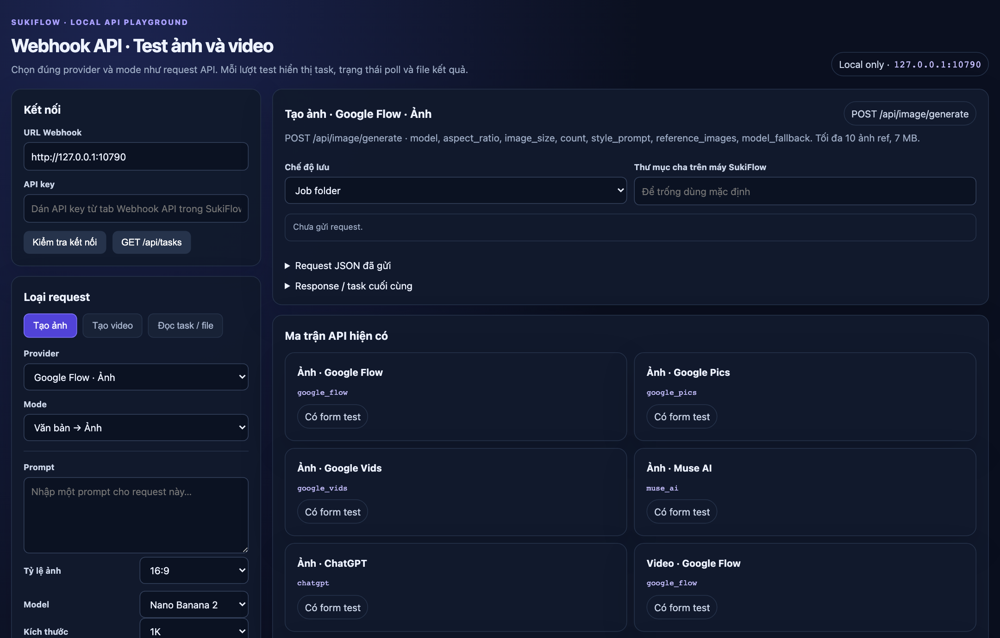

### Primary Endpoints:

| Method | Endpoint | Auth | Description |
|---|---|:---:|---|
| `GET` | `/api/health` | No | Check server availability and active task counts |
| `POST` | `/api/image/generate` | Yes | Generate images via Google Flow, Google Pics, Google Vids Image, Muse AI, or ChatGPT |
| `POST` | `/api/video/generate` | Yes | Generate video via Google Flow, Google Vids, or Muse AI |
| `GET` | `/api/status/{task_id}` | Yes | Check progress and retrieve output file URLs |
| `GET` | `/api/tasks` | Yes | List up to 50 recent tasks |
| `GET` | `/api/files/{file_id}` | Yes | Download generated image or video files |

📖 For complete payload schemas, cURL/Python examples, and batch guidelines, see the **[Full Webhook API Documentation (WEBHOOK_API.md)](WEBHOOK_API.md)**.

---

## Data and privacy

- SukiFlow is a local desktop application; all generated images, videos, audio files, and project data are saved directly to your local disk.
- Session cookies and login states are stored securely in local app data so you do not need to log in repeatedly.
- Logging out of SukiFlow does not erase Linked Accounts; you can toggle, manage, or remove individual accounts in **Setting → Linked Accounts**.
- Never share your `webhook_api.json`, API keys, session tokens, or browser data folders with others.
- SukiFlow automates browser actions on third-party services. You are responsible for complying with each platform's terms of service and usage guidelines.

### Default output directories

| Module | Default location |
|---|---|
| Google Flow Image / Video | `~/Pictures/GoogleFlow_Output` |
| Google Pics | `~/Pictures/GooglePics_Output` |
| Muse AI | `~/Pictures/MuseAI_Output` |
| Auto Flow | `~/Pictures/AutoFlow_Output` |

---

## Troubleshooting

### 1. Connection status does not turn active
- SukiFlow stays idle until a task is queued. When a batch starts, the automated browser launches and connects.
- Do not close browser windows opened by SukiFlow while tasks are running.

### 2. "No linked account available" error
- Open **Setting → Linked Accounts**, select the relevant service (Google Flow, Google Vids, Google Pics, Muse AI), and click **Add Account**. Accounts from one service cannot substitute for another.

### 3. "Access is denied" when updating on Windows
- Close SukiFlow and any background terminal/browser processes before running the EXE installer. Never click **Skip this file**.

### 4. Webhook API returns 401 Unauthorized
- Verify that the `X-API-Key` header in your HTTP request matches the API Key displayed in **Setting → Webhook API**.

### 5. Webhook API unreachable from LAN devices
- In **Setting → Webhook API**, switch the IP binding from `This machine only (127.0.0.1)` to `Local network (0.0.0.0)`. Ensure your host firewall allows incoming connections on port `10790`.

### 6. Slow generation or timeouts
- Check if your linked account has hit platform rate limits or exhausted generation credits.
- Lower the concurrency limit to 1 row to verify baseline connectivity.
- Check **Setting → Logs** for real-time error traces.

---

## Updates

SukiFlow checks for updates upon launch. Always download official releases from:

**[GitHub Releases — SukiFlow](https://github.com/suki-app/sukiflow-doc/releases/latest)**

---

## Notice

SukiFlow is an automation tool. SukiFlow is not affiliated with, sponsored by, or endorsed by Google, OpenAI, Meta, Pexels, Pixabay, or any third-party platforms mentioned. All product names and trademarks remain the property of their respective owners.

<p align="center">
  <br>
  <strong>SukiFlow 1.2.0</strong><br>
  © 2026 SukiFlow
</p>
